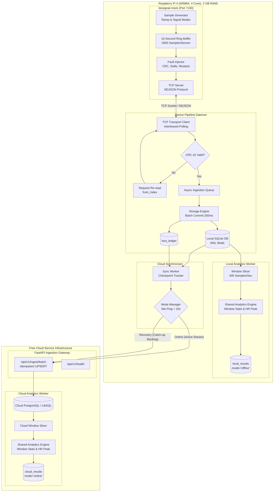
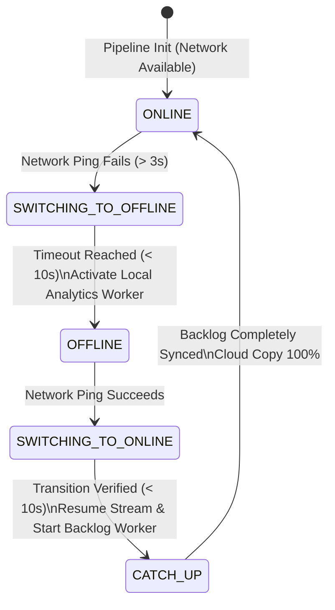
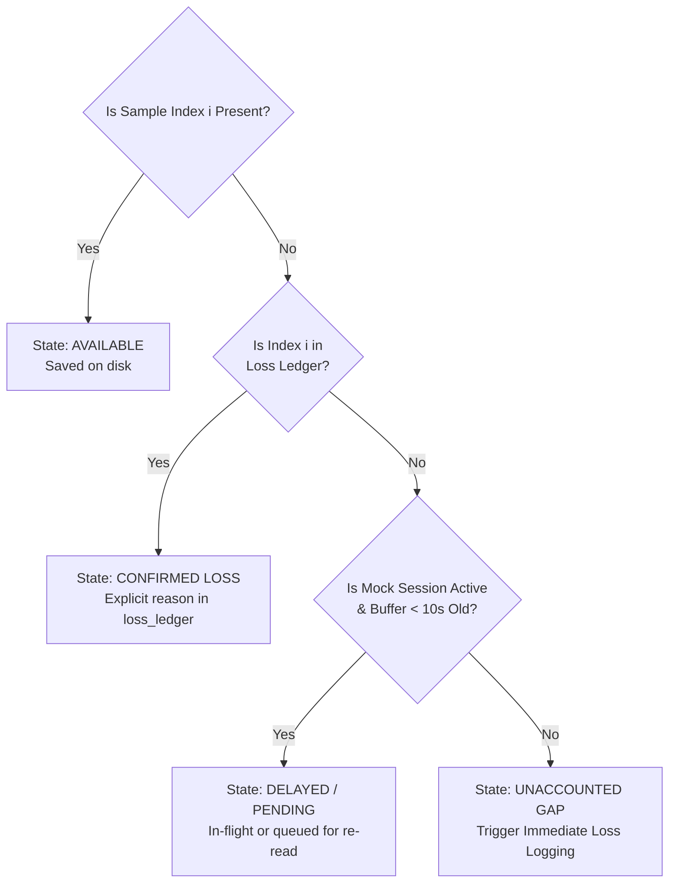
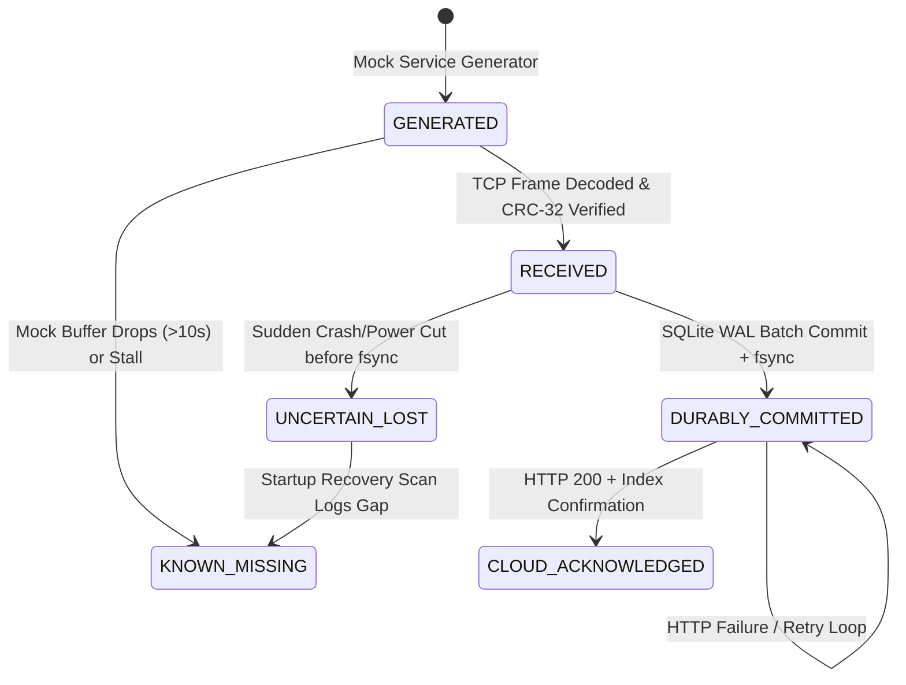

# System Architecture Proposal & Technical Design

**Project:** MayaCardio "Never Lose a Heartbeat" Biosignal Pipeline  
**Document Version:** 1.0.0  
**Phase:** Phase 0 — Engineering Foundation  
**Target Deadline:** October 16, 2026, 2:00 PM IST  

---

## 1. Technology Stack Evaluation & Recommendations

| Proposed Technology | Assessment & Fit Analysis | Recommendation & Rationale |
| :--- | :--- | :--- |
| **Python 3.13** | **Device & Mock Pipeline:** Standard on Linux/ARM64. Highly expressive, rich standard library (`asyncio`, `sqlite3`, `socket`, `zlib`, `struct`, `dataclasses`). Low memory footprint when avoiding heavy scientific libraries (like pandas/scipy) for micro-calculations. | **Adopt:** Utilize Python 3.13 standard library with pure Python math. Keep external dependencies minimal to guarantee $< 150\text{ MB}$ RSS on ARM64. |
| **SQLite (WAL Mode)** | **Local Durable Storage:** World-class embedded ACID database. In Write-Ahead Logging (`WAL`) mode with bounded micro-batches, it delivers sub-millisecond insert times, zero cross-process locking overhead, and crash recovery. | **Adopt:** Standard `sqlite3`. Schema optimized with integer primary keys and WAL mode. Proven resilience against sudden power loss. |
| **FastAPI + Uvicorn** | **Cloud Ingestion Interface:** Asynchronous, lightweight REST/HTTP interface. Handles high-throughput batch uploads with minimal overhead and clear Pydantic/JSON validation. | **Adopt:** Deploy lightweight FastAPI application on cloud hosting with streaming batch ingestion endpoints. |
| **Cloud Database** | **Persistent Cloud Store:** Requires free tier with reliable persistence and zero forced idle sleep during active testing. Options evaluated: Supabase (PostgreSQL), Neon (Serverless Postgres), Turso (LibSQL). | **Adopt (Provisional):** Supabase or Neon PostgreSQL free tier for cloud storage. Alternatively, Turso (LibSQL) for ultra-fast SQLite-compatible cloud replication. |
| **Shared Analytics Module** | **Pure-Python Analytics:** Code parity is critical (Criterion 7). Running the exact same mathematical module on both device (offline mode) and cloud (online mode) eliminates logic drift. | **Adopt:** Maintain `shared/analytics.py` as a zero-dependency pure Python module imported identically by device pipeline and cloud service. |
| **pytest** | **Verification Framework:** Test suite runner for unit, integration, and fault-injection suites. | **Adopt:** Standard test framework, fully compatible with Windows and Linux CI. |

---

## 2. End-to-End System Architecture



---

## 3. Subsystem Architectural Specifications

### 3.1 Mock Service & Boundaries
- **Process Boundary:** Runs as an independent daemon on the device (`biosignal-mock`).
- **Network Interface:** TCP listening on configurable port (default `7100`), accepting one active connection at a time.
- **Protocol:** Newline-delimited JSON (NDJSON).
- **Core Loop:** High-resolution asynchronous timer emitting 400 samples/sec per sensor into a fixed-length ring buffer (10 seconds = 4000 samples).
- **Fault Injection Hooks:**
  - `stall_seconds`: temporarily pause socket replies.
  - `corrupt_crc_ratio`: generate erroneous CRC-32 checksums.
  - `duplicate_reply_ratio`: retransmit identical response frames.
  - `sensor_drop`: suspend generation on a single sensor, generating `lost` records.
  - `session_restart`: abort session, reset index to 0, generate new UUID `session_id`.

### 3.2 Data Acquisition & Protocol Validation
- **Interleaved Polling Scheduler:** Because the mock operates on a single client connection, the client implements a balanced polling loop:
  1. Emit `{"cmd": "read", "sensor": 1}`.
  2. Parse NDJSON frame, record `session_id`.
  3. Validate CRC-32 checksum over the raw bytes of `data` between outer `[` and `]`.
  4. If invalid: emit `{"cmd": "read", "sensor": 1, "from_index": expected_next_1}`.
  5. Emit `{"cmd": "read", "sensor": 2}`.
  6. Repeat step 3–4 for Sensor 2.
- **Throughput Balancing:** Target acquisition rate is 800 samples/sec (400 samples $\times$ 2 sensors). Max response chunk is 1 second (400 samples). Polling loop fires at least 4 times per second per sensor to keep buffer lag $< 0.5\text{ s}$.

### 3.3 Durable Local Write Path
- **Local Database Engine:** SQLite 3 with Write-Ahead Logging (`PRAGMA journal_mode = WAL;`) and synchronous mode set to `NORMAL` or `FULL`.
- **Atomic Micro-Batching:** Ingestion thread places validated samples into an internal lock-free bounded queue. A dedicated storage worker consumes from the queue and issues atomic batch inserts:
  - Commit interval: every **250 ms** or every **200 samples**.
  - Query: `INSERT OR IGNORE INTO samples (session_id, sensor, sample_index, ch1, ch2, ch3) VALUES (?, ?, ?, ?, ?, ?);`
- **Crash & Power Protection:** If the OS or application terminates abruptly, WAL recovery replay restores the database to the last clean 250ms commit boundary.

```mermaid
sequenceDiagram
    participant Mock as biosignal-mock (TCP)
    participant Client as Transport & Ingest
    participant Queue as Memory Queue (Bounded)
    participant Storage as SQLite Storage Worker
    participant Disk as Local Storage (WAL)

    loop Interleaved Read
        Client->>Mock: {"cmd": "read", "sensor": 1}
        Mock-->>Client: NDJSON Reply (data, crc32, lost)
        Client->>Client: Validate CRC-32 (zlib)
        alt CRC Invalid
            Client->>Mock: {"cmd": "read", "sensor": 1, "from_index": N}
        else CRC Valid
            Client->>Queue: Push validated samples & lost entries
        end
    end

    loop Every 250ms or 200 samples
        Storage->>Queue: Drain batch
        Storage->>Disk: BEGIN IMMEDIATE; INSERT OR IGNORE...; COMMIT;
        Storage->>Disk: fsync (periodic)
    end
```

### 3.4 Sample Identity & Session Handling
- **Tuple Identity:** Every sample is uniquely identified by `(session_id, sensor, sample_index)`.
- **Session Transition Logic:**
  - When a reply arrives with a new `session_id`, the ingestion engine:
    1. Checks if the prior session concluded with `session_end: true`.
    2. If not, queries SQLite for `MAX(sample_index)` of the prior session and records a loss record in `loss_ledger`:  
       `{"sensor": S, "from_index": last_index + 1, "to_index": null, "reason": "session_restart"}`.
    3. Initializes session metadata record for the new `session_id`.

### 3.5 Loss Ledger Architecture
- **Schema:**
  ```sql
  CREATE TABLE loss_ledger (
      id INTEGER PRIMARY KEY AUTOINCREMENT,
      session_id TEXT NOT NULL,
      sensor INTEGER NOT NULL,
      from_index INTEGER NOT NULL,
      to_index INTEGER, -- NULL indicates unknown end
      reason TEXT NOT NULL, -- 'mock_buffer_overflow', 'session_restart', 'unrecoverable_crc'
      detected_at TIMESTAMP DEFAULT CURRENT_TIMESTAMP
  );
  ```
- **Auditing Integrity:** The loss ledger is an append-only table. It is exported identically in `pipeline export` to guarantee zero silent loss.

### 3.6 Online Processing & 5-Second Cloud SLA
- **Cloud Streamer:** Reads committed records from local SQLite starting from `cloud_synced_checkpoint`.
- **Push Cadence:** In online mode, pushes micro-batches every 500 ms to the cloud ingestion endpoint (`POST /api/v1/ingest/batch`).
- **Cloud Window Processor:**
  - Upon receiving samples covering index interval $[400w, 400w + 399]$ for both sensors, triggers the shared analytics engine.
  - Stores window analytics record in cloud database with `mode = 'online'`.
  - Latency SLA: From real-time sample generation to cloud result insertion is $< 2.5\text{ s}$, safely satisfying the 5.0-second constraint.

### 3.7 Offline Processing & Automatic Mode Switching
- **Mode State Machine:**



- **Offline Analytics Worker:**
  - While in `OFFLINE` mode, a device background thread polls local SQLite for closed 1-second windows.
  - Slices samples $[400w, 400w + 399]$ and executes the shared analytics engine.
  - Writes results to local `local_results` table with `mode = 'offline'`.

### 3.8 Cloud Synchronization & Catch-Up Throughput
- **The Catch-Up Challenge:** A 2-hour outage generates:
  $$\text{Total Samples} = 2 \times 3600\text{ s} \times 800\text{ samples/s} = 5,760,000\text{ samples}$$
- **Required Throughput:** Must catch up within 15 minutes (900 seconds):
  $$\text{Required Throughput} = \frac{5,760,000}{900\text{ s}} \approx 6,400\text{ samples/second}$$
- **Ingestion Batching Design:**
  - In individual HTTP requests, 6,400 req/s will fail.
  - The synchronizer bundles **2,000 samples per batch** (using gzip-compressed JSON or compact binary payloads).
  - Total requests for 2 hours of data:
    $$\frac{5,760,000}{2,000} = 2,880\text{ HTTP POSTs}$$
  - Average request rate:
    $$\frac{2,880}{900\text{ s}} = 3.2\text{ requests/second}$$
  - A cadence of 3.2 requests/sec of ~50 KB payloads is easily accommodated by any standard free-tier web server.

### 3.9 Required CLI Commands
The single CLI tool `pipeline` provides three subcommands:
1. `pipeline status`:
   - Queries local and cloud checkpoints.
   - Outputs single JSON line:
     ```json
     {"mode": "online", "samples_saved": 144000, "samples_cloud": 143500, "backlog": 500}
     ```
2. `pipeline export --session <ID> --from [device|cloud]`:
   - Streams NDJSON: sample lines followed by loss lines.
   - Sample line: `{"sensor": 1, "index": 120000, "values": [720, 1200, 1560]}`
   - Loss line: `{"sensor": 2, "from_index": 4000, "to_index": 4399, "reason": "buffer_overflow"}`
3. `pipeline results --session <ID>`:
   - Streams NDJSON of window metric objects conforming to Section 3.

### 3.10 Ground-Truth Recording & Comparison
- **Independent Verification Tool (`tools/check_ground_truth.py`):**
  - Consumes the raw ground-truth generation log (or re-generates it deterministically using `--mode ramp/signal --seed S`).
  - Reads `pipeline export` NDJSON.
  - Validates:
    1. Sample count: Every generated sample is either present on disk with exact values or explicitly listed in the loss ledger.
    2. Zero duplicates: No index appears more than once.
    3. Value fidelity: Every channel value matches ground truth bit-for-bit.
    4. Window result accuracy: Recomputes Section 3 formulas and compares against `pipeline results`.

---

## 4. Deduplication & Loss Discrimination Mechanics

### 4.1 Preventing Duplicate Records
Duplicate prevention is enforced at three architectural boundaries:
1. **Local Disk Boundary:** The composite primary key `(session_id, sensor, sample_index)` in SQLite combined with `INSERT OR IGNORE` ensures that duplicate mock replies or overlapping re-reads cannot produce duplicate rows.
2. **Network Sync Boundary:** The cloud database schema enforces the identical composite primary key `(session_id, sensor, sample_index)`. Ingestion uses idempotent UPSERT (`ON CONFLICT DO NOTHING`).
3. **Export Boundary:** The export query executes `SELECT ... FROM samples WHERE session_id = ? ORDER BY sensor, sample_index;`, guaranteeing strictly monotonic, unique sample streams.

### 4.2 Distinguishing Confirmed Loss vs. Delayed / Unavailable Data



- **Delayed Data:** A sample index that has not yet been fetched from the mock, but the mock session is active and elapsed time is $< 10.0\text{ seconds}$. The pipeline continues normal polling or issues a re-read.
- **Confirmed Loss:**
  1. The mock explicitly returns the index in its `lost` payload.
  2. The mock terminates unexpectedly or restarts with a new session ID (`to_index: null`).
  3. Re-read retries exceed limit or the 10-second ring buffer expires.
- **Resulting Invariant:** At the time of session completion or export, every sample index in the span $[0, \max(\text{index})]$ is either stored in `samples` or accounted for in `loss_ledger`. Zero silent gaps are permitted.

### 4.3 Sample Lifecycle States & Durability Semantics

To prevent ambiguous states and ensure strict engineering rigor, the pipeline defines five mutually exclusive states for every sample:



1. **State: GENERATED**
   - **Location:** Inside `biosignal-mock` internal ring buffer.
   - **Semantics:** Sample exists mathematically in memory. If not read within 10 seconds, it transitions directly to `KNOWN_MISSING` via the mock's `lost` payload.
2. **State: RECEIVED (Volatile In-Memory)**
   - **Location:** TCP buffer or `asyncio.Queue` in pipeline memory.
   - **Semantics:** Frame received, NDJSON parsed, CRC-32 verified. **CRITICAL:** A sample in `RECEIVED` state is NOT yet safe. A process kill or power cut will destroy it. It must NEVER be reported as saved or acknowledged.
3. **State: DURABLY COMMITTED (Local Disk)**
   - **Location:** SQLite database file on physical storage (`PRAGMA journal_mode = WAL;`, `fsync()` completed).
   - **Semantics:** The transaction batch has committed and the kernel has flushed bytes to non-volatile media. It will survive process kill (`SIGKILL`), reboot, and physical power loss within the guaranteed 0.5s bound.
4. **State: CLOUD ACKNOWLEDGED (Remote Persistent Store)**
   - **Location:** Cloud PostgreSQL / LibSQL database.
   - **Semantics:** An HTTP write is NOT considered safe upon socket write or HTTP return code alone. The cloud endpoint returns an explicit JSON payload confirming `{"acknowledged_up_to": {"1": idx1, "2": idx2}}` after durable commit in the cloud database. Only upon parsing this acknowledgment does the device advance its `cloud_synced_checkpoint`.
5. **State: KNOWN MISSING (Loss Ledger)**
   - **Location:** `loss_ledger` table on disk and cloud.
   - **Semantics:** Confirmed dropped indices recorded with exact metadata (`sensor`, `from_index`, `to_index`, `reason`). Gaps are never interpolated or filled with synthetic values.

---

## 5. Engineering Boundaries & Scope Discipline

1. **Simplest Viable Architecture:**
   - Every dependency is justified: standard Python 3.13 standard library (`asyncio`, `sqlite3`, `socket`, `zlib`) for edge acquisition; FastAPI + Uvicorn for standard HTTP ingestion; pytest for testing. No unnecessary message brokers, no heavyweight ORMs, no external C libraries.
2. **Clinical Interpretation Disclaimer:**
   - The synthetic ECG and PPG signals generated in `--mode signal` are strictly for software systems verification (heart rate peak detection, frequency tracking, stress testing). They are not intended for clinical diagnosis, patient monitoring, or medical device certification.
3. **Transparency of Uncertain States:**
   - When a session restarts or an unannounced crash occurs, the exact end of missing data may be unknown. The pipeline records `to_index: null` rather than guessing the boundary.

