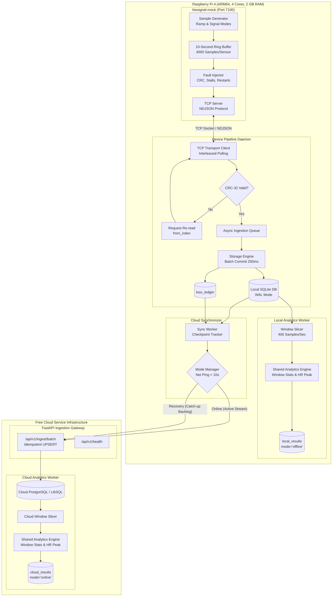
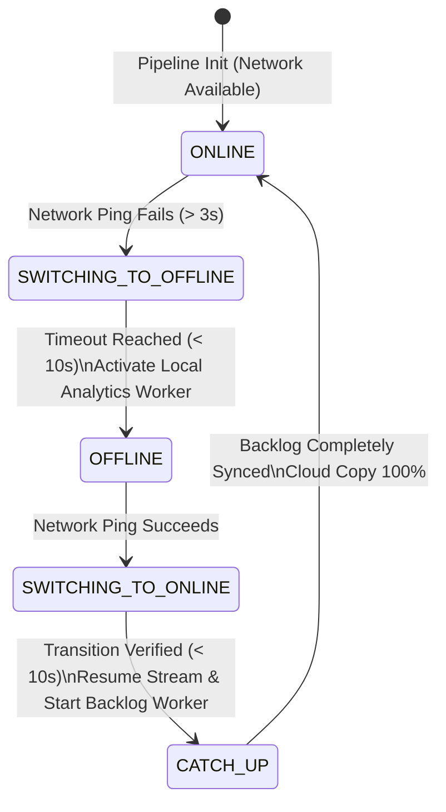
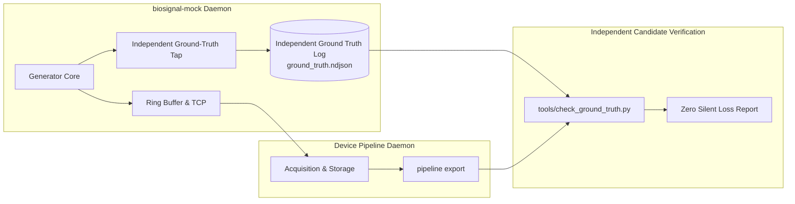
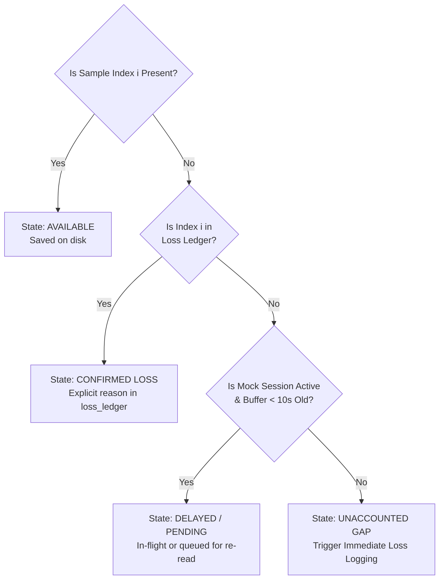
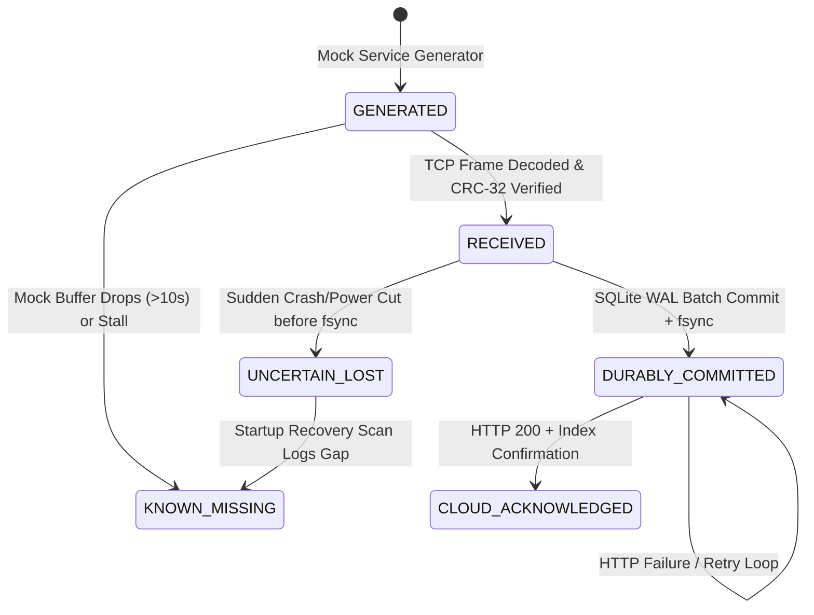

# System Architecture Proposal & Technical Design

**Project:** MayaCardio "Never Lose a Heartbeat" Biosignal Pipeline  
**Document Version:** 1.0.0  
**Phase:** Phase 0 — Engineering Foundation  
**Target Deadline:** October 16, 2026, 2:00 PM IST  

---

## 1. Technology Stack Evaluation & Recommendations

| Proposed Technology | Assessment & Fit Analysis | Recommendation & Rationale |
| :--- | :--- | :--- |
| **Python 3.13** | **Device & Mock Pipeline:** Standard on Linux/ARM64. Highly expressive, rich standard library (`asyncio`, `sqlite3`, `socket`, `zlib`, `struct`, `dataclasses`). Low memory footprint when avoiding heavy scientific libraries (like pandas/scipy) for micro-calculations. | **Adopt:** Utilize Python 3.13 standard library with pure Python math. Keep external dependencies minimal to guarantee $< 150\text{ MB}$ RSS on ARM64. |
| **SQLite (WAL Mode)** | **Local Durable Storage:** World-class embedded ACID database. In Write-Ahead Logging (`WAL`) mode with bounded micro-batches, it delivers sub-millisecond insert times, zero cross-process locking overhead, and crash recovery. | **Adopt:** Standard `sqlite3`. Schema optimized with integer primary keys and WAL mode. Proven resilience against sudden power loss. |
| **FastAPI + Uvicorn** | **Cloud Ingestion Interface:** Asynchronous, lightweight REST/HTTP interface. Handles high-throughput batch uploads with minimal overhead and clear Pydantic/JSON validation. | **Adopt:** Deploy lightweight FastAPI application on cloud hosting with streaming batch ingestion endpoints. |
| **Cloud Database** | **Persistent Cloud Store:** Requires free tier with reliable persistence and zero forced idle sleep during active testing. Options evaluated: Supabase (PostgreSQL), Neon (Serverless Postgres), Turso (LibSQL). | **Adopt (Provisional):** Supabase or Neon PostgreSQL free tier for cloud storage. Alternatively, Turso (LibSQL) for ultra-fast SQLite-compatible cloud replication. |
| **Shared Analytics Module** | **Pure-Python Analytics:** Code parity is critical (Criterion 7). Running the exact same mathematical module on both device (offline mode) and cloud (online mode) eliminates logic drift. | **Adopt:** Maintain `shared/analytics.py` as a zero-dependency pure Python module imported identically by device pipeline and cloud service. |
| **pytest** | **Verification Framework:** Test suite runner for unit, integration, and fault-injection suites. | **Adopt:** Standard test framework, fully compatible with Windows and Linux CI. |

---

## 2. End-to-End System Architecture



---

## 3. Subsystem Architectural Specifications

### 3.1 Mock Service & Boundaries
- **Process Boundary:** Runs as an independent daemon on the device (`biosignal-mock`).
- **Network Interface:** TCP listening on configurable port (default `7100`), accepting one active connection at a time.
- **Protocol:** Newline-delimited JSON (NDJSON).
- **Core Loop:** High-resolution asynchronous timer emitting 400 samples/sec per sensor into a fixed-length ring buffer (10 seconds = 4000 samples).
- **Fault Injection Hooks:**
  - `stall_seconds`: temporarily pause socket replies.
  - `corrupt_crc_ratio`: generate erroneous CRC-32 checksums.
  - `duplicate_reply_ratio`: retransmit identical response frames.
  - `sensor_drop`: suspend generation on a single sensor, generating `lost` records.
  - `session_restart`: abort session, reset index to 0, generate new UUID `session_id`.

### 3.2 Data Acquisition, Bounded Queuing & Backpressure
- **Interleaved Polling Scheduler:** Because the mock operates on a single client connection, the client implements a balanced polling loop:
  1. Emit `{"cmd": "read", "sensor": 1}`.
  2. Parse NDJSON frame, record `session_id`.
  3. Validate CRC-32 checksum over the raw bytes of `data` between outer `[` and `]`.
  4. If invalid: emit `{"cmd": "read", "sensor": 1, "from_index": highest_contiguous_resolved_index_1 + 1}` (bounded to 3 retries).
  5. Emit `{"cmd": "read", "sensor": 2}`.
  6. Repeat step 3–4 for Sensor 2.
- **Protocol Validation Decoupled from Storage:** CRC-32 and NDJSON framing validation occurs strictly in memory within the transport worker before any interaction with the storage queue. Corrupt payloads are discarded immediately; corrupted values never reach the queue or database.
- **CRC/Integrity Incidents vs. Confirmed Loss:**
  - When `parse_mock_reply()` detects a checksum mismatch, it is classified as an **Unresolved Transport/Integrity Incident**, NOT a confirmed data loss. The source generator may still hold valid data in its 10-second ring buffer.
  - **Three failed CRC retries alone must NOT establish that samples are permanently lost.**
  - **Separation of Transport Polling Cursor ($C_{\text{poll}}$) and Persisted Recovery Cursor ($I_{\text{resolved}}$):**
    - The **Transport Polling Cursor ($C_{\text{poll}}$)** is an in-memory, wire-level tracking index indicating the next index to request from the mock (`{"cmd": "read", "sensor": S, "from_index": C_poll}`).
    - The **Persisted Recovery Cursor ($I_{\text{resolved}}$)** is the durable checkpoint committed in SQLite (`checkpoints.contiguous_resolved_index`).
    - When 3 consecutive re-reads fail on an interval $[f, t]$, the client avoids deadlocking the dual-sensor polling loop by advancing its transport cursor to $C_{\text{poll}} = t + 1$.
    - **Reachability Guarantee:** Advancing $C_{\text{poll}}$ on the wire **does NOT make the unresolved range unreachable**. The interval $[f, t]$ is registered in an in-memory **`unresolved_crc_incidents`** queue.
    - Crucially, `highest_contiguous_persisted_index` ($I_{\text{persisted}}$) and `highest_contiguous_resolved_index` ($I_{\text{resolved}}$) **DO NOT advance** across the unresolved gap. They remain frozen at the last contiguous resolved index prior to the incident ($f - 1$).
    - Forward samples arriving after the gap are stored in `samples` and advance `highest_observed_index` ($I_{\text{obs}}$), but no entry is written to `loss_ledger`.
  - **In-Process Unresolved Range Reconciliation (Gap Re-polling Sweeper):**
    The client does NOT rely solely on process restarts to recover unresolved gaps. During the same process lifetime, the transport worker actively returns to pending gaps in `unresolved_crc_incidents`:
    1. *Quiescent Catch-up Trigger:* Whenever a forward poll returns `count < 400` (indicating the pipeline has caught up to the mock's real-time generation front), the client immediately dispatches a targeted re-read for the pending gap: `{"cmd": "read", "sensor": S, "from_index": incident.from_index}`.
    2. *Periodic Sweeper Trigger:* If forward polling remains continuous at 400 samples/response, the transport scheduler interleaves a targeted re-read for the oldest unresolved incident every 1.0 second (well within the mock's 10.0-second buffer retention window).
    3. *Reconciliation Outcomes:*
       - *Successful Recovery:* If the re-read returns valid CRC-32, the batch is inserted into `samples`, the incident is dequeued from `unresolved_crc_incidents`, and the storage transaction automatically advances $I_{\text{persisted}}$ and $I_{\text{resolved}}$ across the gap and through any forward samples already stored up to $I_{\text{obs}}$. Zero false loss is recorded.
       - *Authoritative Eviction:* If the mock has already overwritten the data in its 10-second ring buffer, it returns an explicit `lost: [{"from_index": X, "to_index": Y, "reason": "buffer_overflow"}]`. Storage commits this authoritative source loss to `loss_ledger`, dequeues the incident, and advances $I_{\text{resolved}}$.
       - *Persistent Wire Failure:* If retries continue to fail, the incident remains queued for the next sweep cycle until either recovered, evicted by the mock, or terminated by session restart.
  - **Evidence Required to Transition an Incident to Confirmed Loss:**
    1. *Authoritative Source Drop:* The mock advances past its 10-second buffer capacity and returns an explicit loss span in `lost: [{"from_index": X, "to_index": Y, "reason": "buffer_overflow"}]`. Only when this authoritative source drop is received does the pipeline write to `loss_ledger` and advance $I_{\text{resolved}}$ across the gap.
    2. *Server Restart / Session Transition:* The server connection resets and issues a new `session_id`, terminating the previous session. The unclosed interval from $I_{\text{resolved}} + 1$ onwards is recorded in `loss_ledger` with `to_index: null` and `reason: "session_restart"` (preserving terminal uncertainty).
    3. *Pipeline Restart Recovery:* If neither event occurs before a pipeline restart, restart recovery re-polls from $I_{\text{resolved}} + 1$. If the samples remain in the mock's 10-second ring buffer, they are recovered cleanly without loss.
- **Queue Sizing & Backpressure Analysis:**
  - **Queue Entry Granularity:** Queue entries are **Response Batches** (`IngestBatch`), not individual samples. Each batch contains: `session_id: str`, `sensor: int`, `first_index: int`, `samples: list[list[int]]` (up to 400 samples), and `lost: list[LossRecord]`.
  - **Throughput & Capacity Math for Dual 400 Hz Sensors:**
    - Two independent sensors at 400 Hz each = **800 samples per second** total (400 samples/s for Sensor 1, 400 samples/s for Sensor 2).
    - A single mock reply delivers at most 1 second of data for ONE sensor, capped at **400 samples per response** (Section 6.2).
    - At nominal 4 Hz polling (every 250 ms), each sensor generates 100 samples per batch ($\approx 8$ batches/sec total across both sensors).
    - **Queue Capacity Bound:** Capped at **50 response batches** (`asyncio.Queue(maxsize=50)`).
      - Maximum capacity: $50 \text{ batches} \times 400 \text{ samples/batch} = 20,000 \text{ samples total}$.
      - Time horizon: $\frac{20,000 \text{ samples}}{800 \text{ samples/s}} = \mathbf{25.0 \text{ seconds of dual-sensor data}}$.
      - Under nominal 100-sample batches: $50 \times 100 = 5,000 \text{ samples} = \mathbf{6.25 \text{ seconds of dual-sensor data}}$.
    - **Memory Footprint:**
      - Sensor 1 sample (3 channels) + Sensor 2 sample (2 channels) average $\approx 68$ bytes per sample in Python.
      - 20,000 samples $\times$ 68 bytes $\approx 1.36\text{ MB} + 0.5\text{ MB}$ queue/batch overhead $<\mathbf{2.0\text{ MB}}$, representing $< 0.1\%$ of the 2 GB device RAM.
  - **Backpressure Behavior:**
    - When the queue reaches capacity (50 batches), `await queue.put()` blocks asynchronously.
    - Polling pauses; no new `read` commands are issued.
    - TCP socket buffers fill up and TCP flow control halts mock socket sends.
    - Samples accumulate in the mock's 10-second (4000 sample) ring buffer.
    - If storage remains stalled for $> 10$ seconds, the mock drops older samples and logs `buffer_overflow`.
    - Once disk I/O drains the queue, polling resumes. The mock's subsequent reply includes the `lost: [{"from_index": X, "to_index": Y, "reason": "buffer_overflow"}]` record, which the pipeline commits to `loss_ledger`. RAM never grows unboundedly.

### 3.3 Durable Local Storage & SQLite Durability Architecture
- **Local Database Engine:** SQLite 3 with Write-Ahead Logging (`PRAGMA journal_mode = WAL;`).
- **Durability Comparison: `synchronous = NORMAL` vs. `synchronous = FULL`:**
  - **`WAL` + `synchronous = NORMAL` (Operational Baseline):**
    - *What it guarantees:* 100% durability against user-space process crashes (`SIGKILL`, segfaults, unhandled exceptions). Checksummed WAL frame headers guarantee zero database corruption; incomplete transactions are rolled back cleanly during automatic recovery on next open.
    - *What it does NOT guarantee:* Does not guarantee survival of dirty OS page cache across an abrupt, unannounced physical power cut. `NORMAL` syncs the WAL file only during checkpoints (default every 1000 pages or explicit `wal_checkpoint`). Data committed between checkpoints may be lost if power collapses before the OS flushes dirty pages.
  - **`WAL` + `synchronous = FULL` (High-Durability Sync Mode):**
    - *What it guarantees:* Issues an `fsync()` on the WAL file on every batch commit, forcing dirty pages from OS cache to the disk controller write cache before `COMMIT` returns.
    - *What it does NOT guarantee on commodity hardware:* Commodity SD cards, eMMC, and USB flash memory lack hardware Power-Loss Protection (PLP) supercapacitors. Internal flash controller volatile caches can drop data during abrupt $V_{cc}$ collapse, and flash block erases in-flight can cause sector tearing. Furthermore, per-commit `fsync` incurs 20–50 ms latency on flash media, causing severe write amplification.
- **Durability Classification: Target vs. Promise:**
  - A sample is defined as **`COMMITTED`** only after its enclosing transaction commits successfully to the SQLite WAL file.
  - **No 0.5-second guarantee is promised without empirical evidence:** The 0.50-second bound is strictly an **UNVERIFIED DESIGN TARGET** based on 250 ms micro-batching. No empirical claim of 0.5-second power-loss durability is valid until verified by physical power-cut testing (Section 5.1 of `test-strategy.md`) on the target ARM64 hardware.
- **Explicit Duplicate Integrity Check:**
  - Blind `INSERT OR IGNORE` is strictly prohibited.
  - When an incoming sample $(s, i)$ matches an existing record:
    - If channel values are **identical**: Safe duplicate (transport re-transmission). Telemetry counter `duplicate_samples_ignored` is incremented, and duplicate insertion is skipped.
    - If channel values are **different**: Integrity Violation! An `IntegrityConflictError` is raised, a security defect alert logged, and existing committed data is preserved without silent overwrite.

### 3.4 Three-Cursor Model & Invariant Relationships
To prevent skipping unpersisted or unresolved samples upon restart or gapped arrivals, the storage engine tracks three distinct cursors per `(session_id, sensor)`:

1. **`highest_contiguous_persisted_index` ($I_{\text{persisted}}$):**
   - The highest sample index $k$ such that **every** index $0 \le i \le k$ is physically stored and validated in `samples`.
   - Contains zero loss records and zero gaps; represents the strict contiguous verified sample boundary.
   - Used by local window analytics workers to ensure Section 3 windows ($[400w, 400w + 399]$) only process verified, unbroken sample sequences.
2. **`highest_contiguous_resolved_index` ($I_{\text{resolved}}$) (persisted in `checkpoints`):**
   - The highest index $m$ such that **every** index $0 \le i \le m$ is either:
     - Persisted in `samples`, OR
     - Formally accounted for by an authoritative source loss record in `loss_ledger` (e.g. `buffer_overflow`, `sensor_stall`).
   - Bridges across confirmed gaps without falsely marking missing data as persisted.
3. **`highest_observed_index` ($I_{\text{obs}}$):**
   - The maximum sample index seen on the wire or stored in `samples`.
   - Used to detect re-transmissions, duplicate frames, and potential forward gaps.

#### Exact Mathematical & Ordering Invariant:
$$-1 \le I_{\text{persisted}} \le I_{\text{resolved}} \le I_{\text{obs}}$$
*(where $-1$ represents an uninitialized sensor session before any samples or loss records exist).*

- **Why $I_{\text{persisted}} \le I_{\text{resolved}}$:** Every contiguous persisted sample is by definition resolved. When no loss records exist, $I_{\text{persisted}} = I_{\text{resolved}}$. As soon as an authoritative loss record is committed (e.g. indices $1000 \dots 1099$ lost to `buffer_overflow`), $I_{\text{resolved}}$ bridges the loss span and advances to 1099, whereas $I_{\text{persisted}}$ remains at 999 (the boundary of contiguous physical sample data).
- **Why $I_{\text{resolved}} \le I_{\text{obs}}$:** $I_{\text{resolved}}$ cannot exceed what has been received or authoritatively accounted for. If forward samples arrive (e.g. $[1100, 1199]$) while an earlier interval (e.g. $[1000, 1099]$) is unresolved due to a CRC incident, $I_{\text{obs}}$ advances to 1199, but $I_{\text{resolved}}$ and $I_{\text{persisted}}$ remain strictly frozen at 999.
- **Strict Invariant Enforcement:** No storage transaction or database commit may ever violate the monotonic inequality $-1 \le I_{\text{persisted}} \le I_{\text{resolved}} \le I_{\text{obs}}$.

#### Explicit Restart Behavior for Each Cursor:
1. **`highest_contiguous_resolved_index` ($I_{\text{resolved}}$) Restart Behavior:**
   - **Persistence:** Persisted in `checkpoints.contiguous_resolved_index` within the same atomic transaction as sample and loss batch writes.
   - **Restart Action:** On startup, read directly from `checkpoints`. It dictates the initial restart polling command:
     $$\text{from\_index} = I_{\text{resolved}} + 1$$
   - **Guarantee:** Because $I_{\text{resolved}}$ only advances across samples physically stored or authoritative source loss records (`buffer_overflow`, `sensor_stall`), polling resumes exactly at the first unresolved sample. Confirmed dropped samples are never re-requested (preventing fruitless re-read loops), while unpersisted samples or unresolved CRC incidents are immediately re-polled for potential recovery from the mock's 10-second buffer.
2. **`highest_contiguous_persisted_index` ($I_{\text{persisted}}$) Restart Behavior:**
   - **Persistence:** Persisted in `checkpoints.contiguous_persisted_index` (or recomputed from `samples` on boot).
   - **Restart Action:** On startup, read from `checkpoints`. It governs local analytics and export boundaries.
   - **Guarantee:** Local processing workers evaluate only complete windows within $[0, I_{\text{persisted}}]$. If forward samples were persisted ($I_{\text{obs}} > I_{\text{persisted}}$) ahead of a gap, processing windows covering the gap remain deferred until the gap is either filled by newly ingested samples or resolved by an authoritative loss record.
3. **`highest_observed_index` ($I_{\text{obs}}$) Restart Behavior:**
   - **Persistence:** Initialized on startup by querying SQLite: `SELECT COALESCE(MAX(sample_index), -1) FROM samples WHERE session_id = ? AND sensor = ?`.
   - **Restart Action:** Restored to the maximum committed index in `samples`.
   - **Guarantee:** When restart polling begins at $I_{\text{resolved}} + 1$, the mock may deliver samples that were already committed prior to the crash (indices between $I_{\text{resolved}} + 1$ and $I_{\text{obs}}$). Storage uses explicit idempotency checking to safely ignore identical duplicates without failure, while $I_{\text{persisted}}$ and $I_{\text{resolved}}$ advance forward across the re-confirmed samples until aligning with $I_{\text{obs}}$.

### 3.5 Session Transitions & Terminal Uncertainty
- **Tuple Identity:** Every sample is uniquely identified by `(session_id, sensor, sample_index)`.
- **Session Transition Semantics (Uncertainty vs. Measured Loss):**
  - When a reply arrives with `reply.session_id != current_session_id`:
    1. A new `session_id` establishes that a **session transition** occurred (e.g. mock server crashed, rebooted, or was replaced).
    2. **It does NOT establish the exact extent of missing samples in the old session.**
    3. The prior session's data, checkpoints, and loss records remain permanently preserved and untouched. Samples from different sessions are never combined.
    4. If the prior session concluded with `session_end: true`: clean closure, no open gap.
    5. If the prior session did NOT end cleanly:
       - Query `checkpoints.last_saved_index` for the prior session: $i_{\text{last}}$.
       - Record an **open-ended loss record** in `loss_ledger`:
         `{"session_id": old_session, "sensor": S, "from_index": i_last + 1, "to_index": null, "reason": "session_restart"}`.
       - **Preserving Uncertainty:** `to_index: null` represents an unclosed terminal interval of indeterminate extent. The pipeline does not invent an arbitrary end index or present unmeasured samples as quantified loss.
    6. For the new session:
       - Initialize a new checkpoint record for `(new_session_id, sensor)` starting at index 0.
       - Begin reading new session data from index 0.

### 3.6 Loss Ledger Architecture & Deduplication Constraints
- **Loss Table Schema:**
  ```sql
  CREATE TABLE IF NOT EXISTS loss_ledger (
      id INTEGER PRIMARY KEY AUTOINCREMENT,
      session_id TEXT NOT NULL,
      sensor INTEGER NOT NULL CHECK (sensor IN (1, 2)),
      from_index INTEGER NOT NULL CHECK (from_index >= 0),
      to_index INTEGER CHECK (to_index IS NULL OR to_index >= from_index),
      reason TEXT NOT NULL,
      detected_at REAL NOT NULL,
      UNIQUE (session_id, sensor, from_index, to_index, reason)
  );
  ```
- **Strict Loss-Range Merging Rules:**
  Loss ranges must be merged conservatively to prevent masking defects or confusing auditability:
  1. *Never merge across conflicting causes:* A `buffer_overflow` must never be merged with a `sensor_stall` or `transport_disconnect`. Root causes must remain distinct.
  2. *Never merge unresolved incidents with confirmed losses:* Quarantined CRC incidents are not merged with authoritative source drops.
  3. *Never merge if overlapping with persisted samples:* If a loss range $[f, t]$ covers indices that already exist in `samples`, this is a **CONTRADICTORY LOSS CONFLICT**, not a mergeable span! The pipeline must raise an integrity error (`ContradictoryLossConflictError`).
  4. *Valid Merge Criteria:* Two loss spans $[f_1, t_1]$ and $[f_2, t_2]$ are merged into $[\min(f_1, f_2), \max(t_1, t_2)]$ **only if**:
     - They have identical `session_id`, `sensor`, and `reason`;
     - They are strictly adjacent ($t_1 + 1 = f_2$) or overlapping;
     - Zero samples within the unified span exist in `samples`.
- **Distinct Loss Reason Taxonomy:**
  1. `buffer_overflow`: Confirmed source-side ring-buffer overflow reported directly by mock.
  2. `sensor_stall`: Confirmed source-side selective sensor pause reported directly by mock.
  3. `transport_disconnect`: Socket severed during polling and reconnected mock indicates gap older than buffer.
  4. `session_restart`: Mock restarted, creating an open-ended terminal gap (`to_index: null`) for previous session.
  5. `storage_exhaustion`: Local disk full, preventing sample commit.
  *(Note: Unresolved CRC incidents are held in an in-memory quarantined structure and never written to `loss_ledger` unless transitioned to confirmed loss via authoritative source drop or session restart).*

### 3.7 Transaction Atomicity, Cursor Advancement Invariant & Crash Consistency
- **Single-Transaction Boundary:**
  Sample batch inserts, loss ledger records, and checkpoint updates are committed in a single atomic transaction:
  ```python
  with db_connection:  # Automatically issues BEGIN IMMEDIATE ... COMMIT or ROLLBACK
      storage.insert_samples_verified(sample_batch)
      storage.insert_losses_deduped(loss_batch)
      storage.update_checkpoint_verified(session_id, sensor, batch_first, batch_last)
  ```
- **Contiguous Cursor Advancement Invariant:**
  Neither contiguous cursor ($I_{\text{persisted}}$ or $I_{\text{resolved}}$) is ever updated by blindly setting it to an incoming batch's highest index. The storage engine enforces that **a transaction cannot advance either contiguous cursor unless every intervening index is persisted or authoritatively resolved**:
  1. *Forward Arrival Ahead of a Gap ($b_{\text{first}} > I_{\text{resolved}} + 1$):*
     - The incoming batch represents forward samples arriving after an unreceived or unresolved interval.
     - Samples are validated and inserted into `samples`.
     - `highest_observed_index` advances: $I_{\text{obs}} = \max(I_{\text{obs}}, b_{\text{last}})$.
     - **Both $I_{\text{persisted}}$ and $I_{\text{resolved}}$ remain strictly UNCHANGED.** They stay frozen at the boundary prior to the gap.
  2. *Gap-Filling or Contiguous Arrival ($b_{\text{first}} \le I_{\text{resolved}} + 1$):*
     - The batch connects directly to the existing contiguous sequence or fills a previous unresolved hole.
     - The transaction computes new cursor values by verifying unbroken index continuity from the current cursor positions forward:
       - $I_{\text{persisted}}$ advances to the highest $k \ge I_{\text{persisted}}$ such that **every single index** $i \in [I_{\text{persisted}} + 1, k]$ exists in `samples`.
       - $I_{\text{resolved}}$ advances to the highest $m \ge I_{\text{resolved}}$ such that **every single index** $i \in [I_{\text{resolved}} + 1, m]$ exists in `samples` OR is covered by an authoritative record in `loss_ledger`.
     - If previously stored forward samples (stashed up to $I_{\text{obs}}$) now connect seamlessly, $I_{\text{persisted}}$ and $I_{\text{resolved}}$ sweep forward across them until encountering the next gap or reaching $I_{\text{obs}}$.
  3. *Invariant Assertion & Atomic Rollback:*
     - The transaction explicitly asserts: $$-1 \le I_{\text{persisted}} \le I_{\text{resolved}} \le I_{\text{obs}}$$
     - If disk writes fail, or if any integrity violation or discontinuous leap is detected, SQLite rolls back all inserts and checkpoint updates together. Neither cursor can ever skip ahead of an uncommitted or unresolved gap.
- **Rollback Consistency:**
  - On restart, SQLite WAL recovery restores the database to the last committed atomic transaction. The checkpoints match the exact contiguous state of `samples` and `loss_ledger`.

### 3.8 Online Processing & 5-Second Cloud SLA
- **Cloud Streamer:** Reads committed records from local SQLite starting from `cloud_synced_checkpoint`.
- **Push Cadence:** In online mode, pushes micro-batches every 500 ms to the cloud ingestion endpoint (`POST /api/v1/ingest/batch`).
- **Cloud Window Processor:**
  - Upon receiving samples covering index interval $[400w, 400w + 399]$ for both sensors, triggers the shared analytics engine.
  - Stores window analytics record in cloud database with `mode = 'online'`.
  - Latency SLA: From real-time sample generation to cloud result insertion is $< 2.5\text{ s}$, safely satisfying the 5.0-second constraint.

### 3.9 Offline Processing & Automatic Mode Switching
- **Mode State Machine:**



- **Offline Analytics Worker:**
  - While in `OFFLINE` mode, a device background thread polls local SQLite for closed 1-second windows.
  - Slices samples $[400w, 400w + 399]$ and executes the shared analytics engine.
  - Writes results to local `local_results` table with `mode = 'offline'`.

### 3.10 Cloud Synchronization & Catch-Up Throughput
- **The Catch-Up Challenge:** A 2-hour outage generates:
  $$\text{Total Samples} = 2 \times 3600\text{ s} \times 800\text{ samples/s} = 5,760,000\text{ samples}$$
- **Required Throughput:** Must catch up within 15 minutes (900 seconds):
  $$\text{Required Throughput} = \frac{5,760,000}{900\text{ s}} \approx 6,400\text{ samples/second}$$
- **Storage & Network Recalculation:**
  - Raw JSON: $\approx 65\text{ bytes/sample} \implies 374.4\text{ MB}$.
  - Compact array JSON: $\approx 30\text{ bytes/sample} \implies 172.8\text{ MB}$.
  - Gzip wire transfer: $\approx 38.4\text{ MB}$ to $80\text{ MB}$ ($\approx 89\text{ KB/s}$ over 900s).
  - **Database Storage Quota Risk:** In PostgreSQL, individual sample rows incur ~88 bytes each (tuple header + fields + primary key B-tree index). 5.76 million rows consume $\mathbf{\approx 506.8\text{ MB}}$, which **exceeds or exhausts free-tier limits** (Supabase: 500 MB, Neon: 512 MB).
- **Architectural Schema Mitigation (Chunked Cloud Rows):**
  - Rather than storing 5.76 million individual sample rows, the cloud database stores **1-second sample chunk rows** (400 samples per row, 14,400 rows total) or binary bytea blocks.
  - This reduces database metadata and index overhead by $> 95\%$, slashing database disk footprint to $<\mathbf{25\text{ MB}}$ and keeping the system comfortably within free-tier quotas.
- **Batching & Cadence:**
  - Synchronizer pushes batches of 2,000 samples per HTTP POST payload ($2,880\text{ requests}$ over 900 seconds = **3.2 requests/second**).
- **Target Classification:**
  > [!IMPORTANT]
  > The 15-minute catch-up deadline is an **UNVERIFIED TARGET**. It must be validated via a representative benchmark measuring end-to-end network transfer and cloud database persistence before declaring compliance.

### 3.11 Required CLI Commands
The single CLI tool `pipeline` provides three subcommands:
1. `pipeline status`:
   - Queries local and cloud checkpoints.
   - Outputs single JSON line:
     ```json
     {"mode": "online", "samples_saved": 144000, "samples_cloud": 143500, "backlog": 500}
     ```
2. `pipeline export --session <ID> --from [device|cloud]`:
   - Streams NDJSON: sample lines followed by loss lines.
   - Sample line: `{"sensor": 1, "index": 120000, "values": [720, 1200, 1560]}`
   - Loss line: `{"sensor": 2, "from_index": 4000, "to_index": 4399, "reason": "buffer_overflow"}`
3. `pipeline results --session <ID>`:
   - Streams NDJSON of window metric objects conforming to Section 3.

### 3.12 Independent Candidate Ground-Truth Recorder & Auditor
To ensure zero silent data loss before submission, the architecture includes an **independent verification subsystem** completely decoupled from the device pipeline:



1. **Independent Candidate Ground-Truth Recorder:**
   - Embedded directly as an independent recording tap at the mock generation core.
   - Records the actual generated stream at creation: `(session_id, sensor, sample_index, values, timestamp)`.
   - Records all mock session transitions (`new_session_id`, `session_end: false`).
   - Records all mock ring-buffer overflow events directly from the mock buffer tracker.
   - Writes directly to an independent, append-only ground-truth stream (`ground_truth.ndjson`), completely separate from any pipeline database or state.
2. **Independent Candidate Ground-Truth Checker (`tools/check_ground_truth.py`):**
   - Strictly does NOT rely on pipeline-generated truth, pipeline SQLite tables, or internal pipeline logs.
   - Consumes the independent ground-truth log and compares it against the output of `pipeline export --from device` (or `--from cloud`).
   - Auditing Verification Engine:
     - **Missing Samples Detection:** Identifies every index emitted by the generator that is absent from the export. Flags defect unless accounted for by an explicit mock drop event.
     - **Duplicate Samples Detection:** Identifies any sample index that appears more than once in the export stream.
     - **Altered Values Detection:** Compares every channel value bit-for-bit against ground-truth math.
     - **Unaccounted Loss Audit:** Cross-checks exported `loss_ledger` records against ground-truth drop events. Flags any invented loss or unrecorded gap.

---

## 4. Deduplication & Loss Discrimination Mechanics

### 4.1 Preventing Duplicate Records
Duplicate prevention is enforced at three architectural boundaries:
1. **Local Disk Boundary:** The composite primary key `(session_id, sensor, sample_index)` in SQLite combined with `INSERT OR IGNORE` ensures that duplicate mock replies or overlapping re-reads cannot produce duplicate rows.
2. **Network Sync Boundary:** The cloud database schema enforces the identical composite primary key `(session_id, sensor, sample_index)`. Ingestion uses idempotent UPSERT (`ON CONFLICT DO NOTHING`).
3. **Export Boundary:** The export query executes `SELECT ... FROM samples WHERE session_id = ? ORDER BY sensor, sample_index;`, guaranteeing strictly monotonic, unique sample streams.

### 4.2 Distinguishing Confirmed Loss vs. Delayed / Unavailable Data



- **Delayed Data:** A sample index that has not yet been fetched from the mock, but the mock session is active and elapsed time is $< 10.0\text{ seconds}$. The pipeline continues normal polling or issues a re-read.
- **Confirmed Loss:**
  1. The mock explicitly returns the index in its `lost` payload.
  2. The mock terminates unexpectedly or restarts with a new session ID (`to_index: null`).
  3. Re-read retries exceed limit or the 10-second ring buffer expires.
- **Resulting Invariant:** At the time of session completion or export, every sample index in the span $[0, \max(\text{index})]$ is either stored in `samples` or accounted for in `loss_ledger`. Zero silent gaps are permitted.

### 4.3 Sample Lifecycle States & Durability Semantics

To prevent ambiguous states and ensure strict engineering rigor, the pipeline defines five mutually exclusive states for every sample:



1. **State: GENERATED**
   - **Location:** Inside `biosignal-mock` internal ring buffer.
   - **Semantics:** Sample exists mathematically in memory. If not read within 10 seconds, it transitions directly to `KNOWN_MISSING` via the mock's `lost` payload.
2. **State: RECEIVED (Volatile In-Memory)**
   - **Location:** TCP buffer or `asyncio.Queue` in pipeline memory.
   - **Semantics:** Frame received, NDJSON parsed, CRC-32 verified. **CRITICAL:** A sample in `RECEIVED` state is NOT yet safe. A process kill or power cut will destroy it. It must NEVER be reported as saved or acknowledged.
3. **State: DURABLY COMMITTED (Local Disk)**
   - **Location:** SQLite database file on physical storage (`PRAGMA journal_mode = WAL;`, `fsync()` completed).
   - **Semantics:** The transaction batch has committed and the kernel has flushed bytes to non-volatile media. It will survive process kill (`SIGKILL`), reboot, and physical power loss within the targeted 0.5s bound (empirically unverified target).
4. **State: CLOUD ACKNOWLEDGED (Remote Persistent Store)**
   - **Location:** Cloud PostgreSQL / LibSQL database.
   - **Semantics:** An HTTP write is NOT considered safe upon socket write or HTTP return code alone. The cloud endpoint returns an explicit JSON payload confirming `{"acknowledged_up_to": {"1": idx1, "2": idx2}}` after durable commit in the cloud database. Only upon parsing this acknowledgment does the device advance its `cloud_synced_checkpoint`.
5. **State: KNOWN MISSING (Loss Ledger)**
   - **Location:** `loss_ledger` table on disk and cloud.
   - **Semantics:** Confirmed dropped indices recorded with exact metadata (`sensor`, `from_index`, `to_index`, `reason`). Gaps are never interpolated or filled with synthetic values.

---

## 5. Engineering Boundaries, Scope Discipline & Phase 1 Review Gate

1. **Simplest Viable Architecture:**
   - Every dependency is justified: standard Python 3.13 standard library (`asyncio`, `sqlite3`, `socket`, `zlib`) for edge acquisition; FastAPI + Uvicorn for standard HTTP ingestion; pytest for testing. No unnecessary message brokers, no heavyweight ORMs, no external C libraries.
2. **Clinical Interpretation Disclaimer:**
   - The synthetic ECG and PPG signals generated in `--mode signal` are strictly for software systems verification (heart rate peak detection, frequency tracking, stress testing). They are not intended for clinical diagnosis, patient monitoring, or medical device certification.
3. **Transparency of Uncertain States:**
   - When a session restarts or an unannounced crash occurs, the exact end of missing data may be unknown. The pipeline records `to_index: null` rather than guessing the boundary.
4. **Strict Scope Enforcement for Phase 1:**
   - Phase 1 is **strictly confined** to:
     - `shared/protocol.py` (message schemas, zlib CRC-32 validation).
     - `biosignal_mock/` (NDJSON TCP server, 400 Hz ramp/signal generator, 10s ring buffer, fault injector).
     - Independent candidate ground-truth recording tap.
     - Mock-specific unit test suites (`tests/test_mock_protocol.py`, `tests/test_generator.py`).
   - **Explicit Negative Scope:** No device pipeline daemon, SQLite storage engine, mode manager, CLI commands, or cloud ingestion components may be started in Phase 1.

