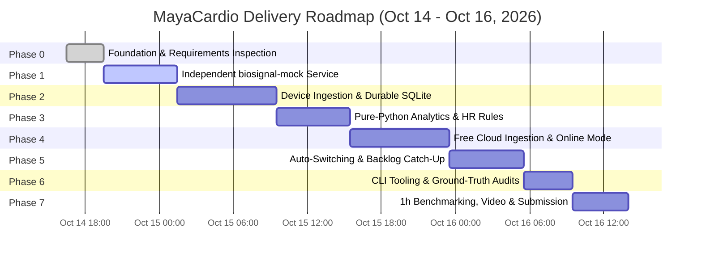

# Time-Boxed Engineering Delivery Plan

**Project:** MayaCardio "Never Lose a Heartbeat" Biosignal Pipeline  
**Document Version:** 1.0.0  
**Baseline Date:** October 14, 2026, 4:35 PM IST  
**Hard Submission Deadline:** October 16, 2026, 2:00 PM IST  
**Total Available Execution Time:** 45.5 Hours  

---

## 1. Guiding Engineering Priorities

The scoring rubric establishes explicit weights:
1. **Data Safety on Device (Criteria 1–3):** 35 Points
2. **Online Mode & Switching (Criteria 4–5):** 25 Points
3. **Complete Cloud Copy (Criterion 6):** 20 Points
4. **Correct Results (Criterion 7):** 10 Points
5. **Design Note, Code Quality & Resource Use (Criterion 8):** 10 Points

**Penalty Rule:** A 5-point deduction applies for every silent loss or unflagged incorrect value up to 30 points. Using a paid service causes immediate disqualification.

**Strategy:** Core data integrity, strict mock protocol compliance, zero silent loss, and automated verification take absolute priority over auxiliary features. No time will be allocated to graphical dashboards, web frontends, or unrequested features.

---

## 2. Milestone Schedule & Work Packages

---

### Work Package Details

#### Phase 0: Engineering Foundation & Requirements Traceability (Hours 0 – 3)
* **Time:** Oct 14, 16:30 – 19:30 IST
* **Deliverables:**
  - `docs/requirements-traceability.md`
  - `docs/risks-and-assumptions.md`
  - `docs/architecture-proposal.md`
  - `docs/test-strategy.md`
  - `docs/delivery-plan.md`
* **Exit Gate:** All requirements classified, environment inspected, test plan established, architecture approved.

#### Phase 1: Shared Core & Independent Mock Service (Strict Scope Boundary)
* **Time:** Oct 14, 19:30 – Oct 15, 01:30 IST
* **Deliverables (Strict In-Scope):**
  - `shared/protocol.py`: shared NDJSON models, exact zlib CRC-32 validation utility.
  - `biosignal_mock/generator.py`: 400 Hz dual-sensor generator core.
  - `biosignal_mock/ramp.py`: deterministic ramp formula `(3i+c) mod 8388608` and `(2i+c) mod 8388608`.
  - `biosignal_mock/signal.py`: realistic ECG/PPG synthetic signal generator.
  - `biosignal_mock/buffer.py`: 10-second (4000 samples) ring buffer with explicit overflow tracking and `lost` payload generation.
  - `biosignal_mock/server.py`: single-client TCP server with NDJSON framing and request-response loop.
  - `biosignal_mock/faults.py`: fault injection hooks (stalls, corrupted CRC-32, duplicate frames, session restarts).
  - Independent Candidate Ground-Truth Recording Tap: source-level recorder emitting `ground_truth.ndjson`.
  - Mock-specific automated unit test suites (`tests/test_mock_protocol.py`, `tests/test_generator.py`).
* **Explicit Negative Scope (Out of Scope for Phase 1):**
  - DO NOT implement `pipeline/` (no transport, storage, loss ledger, mode manager, or CLI).
  - DO NOT implement `cloud_service/` (no FastAPI gateway, cloud database, or sync endpoints).
* **Exit Gate:** All Category A requirements (`REQ-A-01` through `REQ-A-12`) verified and marked `TESTED_PASSED`. Mock verified to implement protocol and faults; independent ground-truth tap verified operational. Stop for candidate review before starting Phase 2.

#### Phase 2: Device Ingestion & Durable Local Storage (Hours 9 – 17)
* **Time:** Oct 15, 01:30 – 09:30 IST
* **Deliverables:**
  - `pipeline/transport.py`: interleaved single-socket TCP client for Dual Sensors.
  - `pipeline/storage.py`: SQLite WAL storage engine, 250ms batch commit, `fsync`.
  - `pipeline/loss_ledger.py`: persistent loss accounting table and logger.
  - `tests/test_storage_durability.py`: crash recovery and duplicate rejection tests.
* **Exit Gate:** Ingests 800 samples/sec continuously without buffer overflow; survives `kill -9` without page corruption; limits power-loss gap to $\le 0.5$ seconds.

#### Phase 3: Analytics Engine & Heart-Rate Rules Parity (Hours 17 – 23)
* **Time:** Oct 15, 09:30 – 15:30 IST
* **Deliverables:**
  - `shared/analytics.py`: window partitioner ($400w$ to $400w+399$), missing count, completeness, mean/min/max per channel, Sensor 2 magnitude, 4-condition ECG peak detector, 5-second window HR calculator.
  - `tests/test_analytics.py`: 100% branch test coverage of Section 3 rules and edge cases ($w < 4$, missing sample $\implies \text{null}$, refractory period $< 100$ samples).
* **Exit Gate:** 100% numerical match against reference calculation; identical behavior when invoked locally or in cloud.

#### Phase 4: Free Cloud Service Ingestion & Online Streaming (Hours 23 – 31)
* **Time:** Oct 15, 15:30 – 23:30 IST
* **Deliverables:**
  - `cloud_service/api.py`: FastAPI ingestion endpoint (`/api/v1/ingest/batch`) with idempotent UPSERT.
  - `cloud_service/processor.py`: cloud-side window aggregator producing results within 5-second SLA.
  - `pipeline/cloud_sync.py`: live streaming worker pushing 500ms batches from local SQLite to cloud.
  - `tests/test_online_mode.py`: latency and 5s SLA verification.
* **Exit Gate:** Cloud receives stream, inserts results with `mode='online'` within 5 seconds of window close, operates strictly within free-tier limits.

#### Phase 5: Offline Mode, Auto-Switching & Backlog Catch-Up (Hours 31 – 37)
* **Time:** Oct 15, 23:30 – Oct 16, 05:30 IST
* **Deliverables:**
  - `pipeline/mode_manager.py`: state machine monitoring cloud health with 3-second ping cadence, triggering transition within 10 seconds.
  - `pipeline/offline_processor.py`: device-side background worker computing Section 3 metrics during offline mode (`mode='offline'`).
  - High-density catch-up sync worker (2,000 samples/batch, 3.2 req/s) clearing 2-hour backlog in $< 15$ minutes.
  - `tests/test_mode_switching.py`: network cut/restore timing and deduplication test.
* **Exit Gate:** Switches to offline in $\le 10$s; switches to online in $\le 10$s; zero dropped/duplicated samples; 2-hour simulated backlog clears in $< 15$ minutes.

#### Phase 6: CLI Tooling & Ground-Truth Verification (Hours 37 – 41)
* **Time:** Oct 16, 05:30 – 09:30 IST
* **Deliverables:**
  - `pipeline/cli.py`: single entrypoint supporting `pipeline status`, `pipeline export`, and `pipeline results`.
  - `tools/check_ground_truth.py`: verification harness auditing sample sets, bit fidelity, and loss ledgers.
  - `tests/test_fault_matrix.py`: automated test runner executing corrupted CRC, duplicate replies, sensor stall, clock change, and disk-full scenarios.
* **Exit Gate:** CLI commands output exact specified NDJSON formats; `check_ground_truth.py` confirms 0 unaccounted samples and 0 duplicate records.

#### Phase 7: ARM64 Benchmarking, Video Recording & Submission (Hours 41 – 45.5)
* **Time:** Oct 16, 09:30 – 14:00 IST
* **Deliverables:**
  - 1-hour resource measurement run (average CPU %, peak RAM MB, disk written MB, network sent MB).
  - 2-page concise design note (`docs/design-note.md`).
  - $\le 5$-minute demo video demonstrating network cut, process kill, and power cut.
  - Final submission repository verification on clean environment.
* **Exit Gate:** Submission packaged, all deliverables verified, zero outstanding blocker issues prior to 2:00 PM IST deadline.

---

## 3. Risk Contingencies & Buffer Allocation

| Potential Blocker | Contingency Plan | Buffer Allocation |
| :--- | :--- | :---: |
| **Free cloud latency or sleeping instance** | Pre-warm instance or switch to lightweight alternative (e.g. Supabase direct DB ingestion or Koyeb instance). | 2.0 Hours |
| **ARM64 local environment unavailability** | Validate inside Docker `linux/arm64` container via QEMU emulation or provision free-tier Oracle Cloud Ampere A1 ARM64 VM. | 2.5 Hours |
| **Edge cases in ECG peak detection** | Dedicated unit test matrix comparing against known mathematical pulse waveforms before pipeline integration. | 1.5 Hours |
| **Submission compilation & video editing** | Video screen capture strictly focused on terminal / test executions without post-production overhead. | 1.5 Hours |
