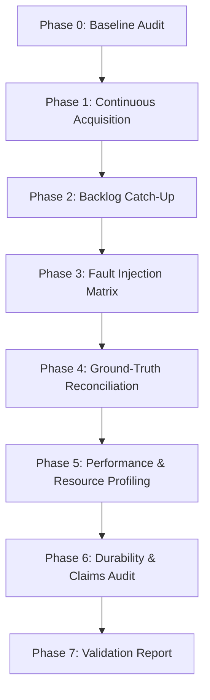

# Phase 2, Increment D — End-to-End Reliability & Performance Validation Plan

- **Document Version:** 1.0.0
- **Target Workspace:** `C:\Users\vaish\.gemini\antigravity-ide\scratch\biosignal-assessment`
- **Baseline Commit:** `282a317` (`feat(storage): add durable SQLite ingestion and recovery`)
- **Baseline Test Suite:** 79 tests passed (2.32s)
- **Execution Environment:** Windows 11 (win32), Python 3.13.5, AMD64 architecture
- **Date:** 2026-10-16

---

## 1. Mission and Validation Philosophy

Increment D is an **adversarial and quantitative validation increment**, not a feature development sprint. The objective is to establish, through reproducible measurements and deterministic fault-injection fixtures, whether the integrated ingestion pipeline (`MockServer` $\rightarrow$ `BiosignalProtocolClient` $\rightarrow$ `StorageIngestionWorker` $\rightarrow$ `StorageEngine`) satisfies the MayaCardio assessment requirements for reliability, throughput, recovery, resource constraints, and data integrity.

### Core Validation Rules:
1. **Evidence over Assumptions:** Completion reports and green test passes must be backed by inspectable metrics and physical SQLite database queries.
2. **Ground-Truth Independence:** The reconciliation oracle must generate expected samples independently of pipeline internal state and cursor calculations.
3. **Durability Truth in Advertising:** SQLite WAL with `synchronous=NORMAL` provides process-crash durability (`SIGKILL`), but does **not** prove host power-loss durability within 0.5s without physical power-loss protection (PLP) capacitor hardware. Power-loss durability is explicitly classified as `UNVERIFIED` until hardware power-cut testing is conducted.
4. **Platform Specificity:** Resource measurements on the current Windows x64 host are recorded as x64 host measurements and are not falsely claimed as ARM64 Raspberry Pi 4 compliance.

---

## 2. Validation Phases and Execution Matrix

### Phase 1 — Continuous Dual-Sensor Acquisition
- **Workload:** Both sensors queried continuously. Sensor 1: 3 channels at 400 Hz; Sensor 2: 2 channels at 400 Hz. Combined nominal rate: 800 samples/sec.
- **Verification Criteria:**
  - Continuous acquisition without thread stalls or queue deadlocks.
  - Correct channel counts per sensor (`len(data[i]) == 3` for Sensor 1; `len(data[i]) == 2` for Sensor 2).
  - Sample indices and values match mock independent ground-truth formulas (`ramp` and `signal`).
  - CRC validation verifies raw `data` JSON text strictly.
  - Identical duplicate replies do not create duplicate database rows.
  - Conflicting sample values abort transactions (`IntegrityConflictError`).
  - Checkpoints are committed atomically with sample batches.
  - Session isolation: no cross-session cursor contamination.
- **Test Strategy:**
  1. Short integration smoke test (100–500 samples).
  2. Sustained acquisition test (accelerated clock / sustained real-time capture).

### Phase 2 — Backlog and Catch-Up Validation
- **Requirement:** Recovery from an outage of up to 2 hours (400 Hz $\times$ 7200 s = 2,880,000 samples/sensor = 5,760,000 samples total).
- **Test Fixture:** Deterministic accelerated backlog test simulating the storage volume and index ranges of the 2-hour backlog without waiting 7,200 wall-clock seconds.
- **Verification Criteria:**
  - Client resumes from earliest unresolved index ($I_{\text{resolved}} + 1$).
  - Storage idempotency: previously committed samples are not duplicated.
  - Cursor advancement never skips unpersisted missing ranges.
  - Authoritative source loss is recorded only when formally reported by protocol.
  - Unresolved uncertainty is quarantined as terminal incident, never fabricated as measured loss.
  - Catch-up throughput exceeds incoming wire rate ($\gg 800$ samples/sec).
  - RSS memory remains bounded throughout high-volume catch-up.

### Phase 3 — Fault-Injection Matrix (14 Scenarios)
The pipeline is stressed under the complete matrix of wire, process, and disk faults:
1. **TCP Disconnect and Reconnect:** Server forcibly closes socket; client reconnects with exponential backoff and resumes from $I_{\text{resolved}} + 1$.
2. **Server Restart & Session Transition:** Server restarts with new session ID; old session unrecovered incidents archived as `terminal = True`; new session cursors reset to 0.
3. **Corrupted CRC with Re-read Recovery:** Server returns corrupted CRC; client sends targeted `read` with `from_index` and recovers data.
4. **Repeated CRC Failure & Quarantine:** Server corrupts CRC across all retry attempts; client isolates range into `unresolved_crc_incidents`, advances transport cursor, and resumes wire stream.
5. **Buffer Eviction / Unrecovered CRC:** Quarantined range is evicted from source ring buffer; mock server later reports authoritative `buffer_overflow` loss; incident transitions to confirmed loss.
6. **Queue Saturation & Source Buffer Overflow:** Worker artificially paused; `accepted_queue` fills to maxsize (backpressure); client pauses reading; server ring buffer overflows and reports loss.
7. **Malformed JSON & Framing Violations:** Oversized frames, invalid JSON syntax, fragmented TCP reads, and multiple replies in a single chunk.
8. **Identical Duplicates & Conflicting Sample Values:** Identical frames ignored safely; conflicting channel values raise `IntegrityConflictError` and roll back.
9. **SQLite Write Failure & Simulated Disk-Full:** `OperationalError` during commit; `task_done()` withheld; batch preserved in `worker.last_failed_batch`; client polling paused.
10. **Crash Consistency after Dequeue:** Worker dequeues batch and process terminates before commit; restart recovers from SQLite checkpoint and re-polls missing data.
11. **Restart After Successful Commit:** Checkpoints restored accurately from SQLite committed state.
12. **Restart with Gaps, Terminal Incidents, and Loss:** Reconstructs $I_{\text{persisted}}$ and $I_{\text{resolved}}$ correctly; unresolved gaps block $I_{\text{resolved}}$; forged checkpoints raise `StorageError`.
13. **Cancellation Safety:** Clean shutdown during wire read, recovery sweep, or storage commit without database corruption.
14. **Database Busy/Locked Handling:** SQLite busy timeout handling and serialization via `StorageEngine._lock`.

### Phase 4 — Independent Ground-Truth Reconciliation
- An automated oracle tool cross-references physical SQLite rows in `samples` and `loss_ledger` against the mathematical formula of the generator (`ramp`: $c$ at $i = (3i+c) \pmod{8388608}$ for Sensor 1, $(2i+c) \pmod{8388608}$ for Sensor 2).
- Validates:
  $$\forall \text{ index } k \in [0, I_{\text{obs}}]: \quad k \in \text{samples} \oplus k \in \text{loss\_ledger} \oplus k \in \text{unresolved\_incidents}$$
  - No index is simultaneously stored and lost.
  - No index is silently omitted without loss or incident tracking.
  - Three-cursor invariant holds: $-1 \le I_{\text{persisted}} \le I_{\text{resolved}} \le I_{\text{obs}}$.

### Phase 5 — Performance and Resource Measurements
- Capture empirical measurements:
  - Sustained acquisition throughput (samples/sec).
  - Catch-up throughput during burst replay.
  - Batch commit latency (ms).
  - Peak RSS memory (MB) using `psutil`.
  - SQLite database file size and WAL file growth.
  - Reconnect latency after socket termination.
  - Restart checkpoint restoration latency.

### Phase 6 — Durability Classification & Claims Audit
- Audit all documentation and code comments for accurate claims:
  - Process crash durability vs host power loss.
  - Reconcile `PRAGMA synchronous = NORMAL` vs `FULL`.
  - Explicitly document 0.5s power cut target as `UNVERIFIED` in absence of PLP hardware.

---

## 3. Requirement Verification Labels

Every requirement in the final validation report will be labeled with one of the following authoritative states:
- `UNTESTED`: Requirement identified but not yet evaluated.
- `IMPLEMENTED`: Code is present in workspace but lacks empirical validation.
- `TESTED_PASSED`: Requirement exercised by automated reproducible test and passed all assertions.
- `TESTED_FAILED`: Test failed or revealed a defect.
- `EXTERNALLY_VERIFIED`: Verified by an independent external tool or hardware fixture.
