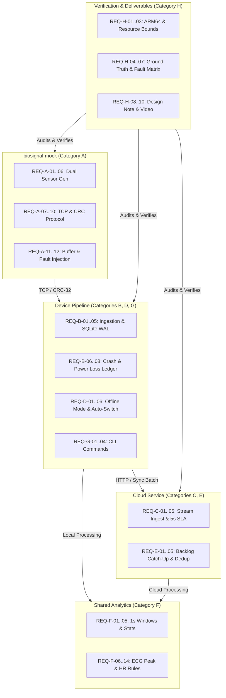

# MayaCardio Requirements Traceability Matrix

**Project:** MayaCardio "Never Lose a Heartbeat" Biosignal Pipeline  
**Document Version:** 1.0.0  
**Phase:** Phase 0 — Engineering Foundation  
**Status:** Baseline Established (All requirements status: Unverified)  
**Target Deadline:** October 16, 2026, 2:00 PM IST  

---

## 1. Traceability Schema & Legend

Each requirement is assigned a deterministic identifier following the schema `REQ-<CATEGORY>-<INDEX>`.

- **Source Section:** Reference to the MayaCardio Candidate Assessment Document ("Never Lose a Heartbeat") or company written clarification.
- **Proposed Component:** Target module in the proposed codebase architecture.
- **Verification Method:** Inspection, Unit Test, Integration Test, Fault Injection Test, or Benchmark.
- **Acceptance Condition:** Exact measurable condition for verification sign-off.
- **Verification Status Schema:** Every requirement tracks its exact verification state:
  - `UNTESTED`: Baseline state. Component design established, but automated tests have not executed yet.
  - `IMPLEMENTED`: Code exists in codebase, but automated test suite has not run or passed. **Rule:** Code existence alone NEVER marks a requirement complete.
  - `TESTED_PASSED`: Automated test in pytest suite executed, assertion passed, and evidence artifact recorded.
  - `TESTED_FAILED`: Automated test executed and failed to satisfy the acceptance condition.
  - `EXTERNALLY_VERIFIED`: Executed and validated on target ARM64 physical hardware or live cloud deployment.

### Sample Lifecycle Classification
All components and tests adhere to 5 strict mutually exclusive sample lifecycle states:
1. `GENERATED`: Emitted by mock generator, buffered in mock memory.
2. `RECEIVED`: Decoded from NDJSON and CRC-validated in device process memory. Volatile; not yet safe.
3. `COMMITTED`: Persisted to local SQLite WAL file with completed `fsync()`. Guaranteed durable within verified power-loss bound.
4. `CLOUD_ACKNOWLEDGED`: Persisted in cloud DB and explicitly acknowledged to device with confirmed index range.
5. `KNOWN_MISSING`: Verified dropped range permanently logged in `loss_ledger` with auditable reason.

---

## Category A: Mock Service Protocol & Deterministic Data Generation

| Req ID | Requirement Summary | Source Section | Proposed Component | Verification Method | Acceptance Condition | Current Status |
| :--- | :--- | :--- | :--- | :--- | :--- | :--- |
| **REQ-A-01** | **Two Independent Sensors at 400 Hz:** The mock service must stream two independent sensors simultaneously, each generating exactly 400 samples per second. Both sensors start synchronously at sample index 0. | Sec 6.1 | `biosignal_mock.generator` | Automated Unit & Integration Test | Sensor 1 and Sensor 2 both emit 400 samples/sec; sample index $i$ corresponds to the exact same relative timestamp for both sensors. | TESTED_PASSED |
| **REQ-A-02** | **Channel Configuration & Word Size:** Sensor 1 must emit 3 channels of signed 24-bit integers ($-8,388,608$ to $8,388,607$). Sensor 2 must emit 2 channels of signed 24-bit integers. | Sec 6.1 | `biosignal_mock.generator` | Unit Test | All emitted integer values fit within signed 24-bit range; Sensor 1 arrays have length 3; Sensor 2 arrays have length 2. | TESTED_PASSED |
| **REQ-A-03** | **Signal Mode ECG Synthetics:** In `--mode signal`, Sensor 1 Channel 2 represents an ECG signal with sharp heartbeat peaks. Heart rate sequence: 60 bpm (minutes 0–2), 90 bpm (minutes 2–4), 72 bpm (minutes 4–6), repeating cyclically. | Sec 6.1 | `biosignal_mock.signal` | Signal Analysis Unit Test | Detected peaks match target rates: 60 bpm in [0, 120s), 90 bpm in [120s, 240s), 72 bpm in [240s, 360s) within 0.1 bpm. | TESTED_PASSED |
| **REQ-A-04** | **Signal Mode Channel Scaling:** In `--mode signal`, Sensor 1 Channel 1 must equal Channel 2 $\times 0.6$, and Channel 3 must equal Channel 2 $\times 1.3$. Sensor 2 Channel 1 must slowly vary near 400,000, and Channel 2 near 150,000. | Sec 6.1 | `biosignal_mock.signal` | Unit Test | Channel 1 and 3 are deterministic linear transforms of Channel 2; Sensor 2 values stay within 10% tolerance around nominal baselines. | TESTED_PASSED |
| **REQ-A-05** | **Ramp Mode Formulaic Generation:** In `--mode ramp`, values are strictly deterministic: Sensor 1 channel $c$ at sample $i$: $(3i + c) \pmod{8,388,608}$; Sensor 2 channel $c$ at sample $i$: $(2i + c) \pmod{8,388,608}$. | Sec 6.1 | `biosignal_mock.ramp` | Mathematical Unit Test | Emitted values match formula across $i \in [0, 10^6]$ and channels $c \in \{0, 1, 2\}$ for Sensor 1 and $c \in \{0, 1\}$ for Sensor 2. | TESTED_PASSED |
| **REQ-A-06** | **Deterministic Seed Reproducibility:** Providing `--seed <int>` must produce identical sample sequences across restarts for any given seed. | Sec 6.1 | `biosignal_mock.generator` | Regression Test | Byte-for-byte identical output for two independent runs using `--seed 7`. | TESTED_PASSED |
| **REQ-A-07** | **TCP Transport & Framing:** The mock service serves newline-delimited JSON (NDJSON) over TCP on `--port <int>`, accepting one client connection at a time. | Sec 6.2 | `biosignal_mock.server` | Network Socket Test | Connection succeeds on configured port; records are terminated by `\n`; second concurrent client is either rejected or queued. | TESTED_PASSED |
| **REQ-A-08** | **Read Command Syntax:** The mock must handle commands: `{"cmd": "read", "sensor": 1}` and `{"cmd": "read", "sensor": 1, "from_index": <int>}`. | Sec 6.2 | `biosignal_mock.server` | Protocol Unit Test | Mock responds with compliant JSON reply matching requested sensor and start index. | TESTED_PASSED |
| **REQ-A-09** | **Reply Structure & Max Payload:** Replies must include `session_id`, `sensor`, `first_index`, `count`, `lost`, `session_end`, `crc32`, and `data`. Payload `data` contains at most 1 second of data (400 samples). | Sec 6.2 | `biosignal_mock.server` | Schema Validation Test | All top-level keys present; `count <= 400`; `len(data) == count`. | TESTED_PASSED |
| **REQ-A-10** | **CRC-32 Checksum Validation:** The `crc32` field must contain the hexadecimal string of the standard zlib CRC-32 computed over the raw text of `data` exactly as sent, from the opening `[` to the matching `]`. | Sec 6.2 | `shared.protocol` | Checksum Unit Test | Computed `hex(zlib.crc32(raw_data_bytes))` strictly equals reply `crc32`. Hardened token scanner extracts exact array substring across adversarial JSON structures; literal test vector `f9a5bf62` verified. | TESTED_PASSED |
| **REQ-A-11** | **Mock Ring Buffer & Overflow:** The mock maintains an internal ring buffer holding only the last 10 seconds of data per sensor (4000 samples). Samples not read in time are dropped and reported in the `lost` array. | Sec 6.2 | `biosignal_mock.buffer` | Buffer Timing Test | Pausing client read for >10s results in exact non-overlapping loss range `[from_index, to_index]` with reason `buffer_overflow`; delivered samples are never marked lost. Verified with exact count assertions. | TESTED_PASSED |
| **REQ-A-12** | **Fault Injection Capabilities:** The mock must support simulated faults: temporary stall/unresponsive socket, corrupted CRC-32, duplicated replies, selective sensor stalls, and session restarts. | Sec 6.3 | `biosignal_mock.faults` | Fault Injection Integration Test | Mock accurately injects each fault type: corrupt CRC, duplicate frames, session restart, and selective sensor stall (withholding stalled sensor while other continues). Deterministically verified in `test_server.py`. | TESTED_PASSED |

---

## Category B: Local Sample Collection & Durable Storage

| Req ID | Requirement Summary | Source Section | Proposed Component | Verification Method | Acceptance Condition | Current Status |
| :--- | :--- | :--- | :--- | :--- | :--- | :--- |
| **REQ-B-01** | **Continuous Ingestion:** The device pipeline must continuously acquire data from both sensors via the mock TCP interface without blocking or falling behind. | Sec 2.1 | `pipeline.ingest` | 1-Hour Soak Test | Zero buffer overflow losses during nominal 1-hour continuous run. | UNTESTED |
| **REQ-B-02** | **Interleaved Single-Connection Polling:** Because the mock accepts one client at a time, the pipeline must manage interleaving reads for Sensor 1 and Sensor 2 over the single socket without starvation. | Sec 6.2 | `pipeline.transport` | Concurrency Unit Test | Both sensors polled at nominal 400 Hz average throughput; neither sensor buffer reaches 10-second overflow limit. | UNTESTED |
| **REQ-B-03** | **Durable Storage on Disk:** Every received sample must be written to durable local storage (SQLite in WAL mode) before confirmation. | Sec 2.1, Sec 4 | `pipeline.storage` | Database Verification Test | Database contains all received sample indices; zero data loss on clean termination. | UNTESTED |
| **REQ-B-04** | **Corruption Detection & Re-Read:** The pipeline must validate the CRC-32 on every reply. Corrupt replies must be rejected and re-requested using `from_index`. | Sec 6.2, Sec 6.3 | `pipeline.transport` | Fault Injection Test | Corrupted replies do not corrupt database; correct samples are recovered via re-read if within 10-second buffer window. | UNTESTED |
| **REQ-B-05** | **Duplicate Rejection:** Duplicate replies sent by the mock must be discarded idempotently without altering local storage state. | Sec 6.3 | `pipeline.storage` | Unit & Integration Test | Local storage enforces `PRIMARY KEY (session_id, sensor, index)`; duplicates result in zero duplicate rows and zero errors. | UNTESTED |
| **REQ-B-06** | **Process Crash Survival:** Saved data must survive sudden process termination (`SIGKILL`). | Sec 2.1, Sec 4 | `pipeline.storage` | Crash Injection Test | Pipeline terminated with `kill -9`; upon restart, all transactions committed prior to kill are fully intact. | UNTESTED |
| **REQ-B-07** | **Power Loss Durability Bound (Target):** The pipeline must specify and guarantee a maximum data loss bound on sudden power loss (unverified design target: $\le 0.5$ seconds), backed by SQLite WAL batching and `fsync`. | Sec 4, Sec 5 | `pipeline.storage` | Empirical Power-Cut Test | Abrupt unbuffered power cut results in 0 database corruption (`PRAGMA integrity_check`); measured loss gap $\le \text{Target Bound}$; post-boot recovery logs gap in `loss_ledger`. | UNTESTED (Target) |
| **REQ-B-08** | **Explicit Loss Ledger:** Any loss detected (from mock `lost` array, buffer overflow, or session restart) must be persisted immediately into a local loss ledger. | Sec 2.6, Sec 4 | `pipeline.loss_ledger` | Ledger Verification Test | Every missing index range is recorded with `sensor`, `from_index`, `to_index`, and `reason`. | UNTESTED |

---

## Category C: Online Cloud Ingestion & Processing

| Req ID | Requirement Summary | Source Section | Proposed Component | Verification Method | Acceptance Condition | Current Status |
| :--- | :--- | :--- | :--- | :--- | :--- | :--- |
| **REQ-C-01** | **Continuous Cloud Streaming:** In online mode, acquired samples must stream continuously to the cloud ingestion service. | Sec 2.2 | `pipeline.cloud_sync` | End-to-End Latency Test | Samples transmitted to cloud in micro-batches with queue latency $< 1.0$ second. | UNTESTED |
| **REQ-C-02** | **5-Second Cloud Processing SLA:** In online mode, processing results for each 1-second window $w$ must be produced and recorded in the cloud within 5 seconds of the window close. | Sec 2.2, Sec 4 | `cloud_service.processor` | SLA Timing Test | Timestamp difference: $\text{cloud\_processed\_time}(w) - \text{window\_end\_time}(w) \le 5.0$ seconds for $\ge 99.9\%$ of windows. | UNTESTED |
| **REQ-C-03** | **Cloud Ingestion Idempotency:** The cloud endpoint must accept sample batches idempotently, handling duplicated network deliveries cleanly. | Sec 4 | `cloud_service.api` | Deduplication Test | Re-sending identical sample batches does not create duplicate database rows or distort window calculations. | UNTESTED |
| **REQ-C-04** | **Free-Tier Cloud Compliance:** The cloud service must run entirely within verified free tiers of cloud providers without incurring charges. | Sec 1, Sec 5 | `cloud_service.deployment` | Cloud Billing Audit | Zero credit card charge; deployment relies strictly on free quotas. | UNTESTED |
| **REQ-C-05** | **Online Mode Tagging:** Results generated by the cloud pipeline must have `mode = "online"`. | Sec 3 | `shared.analytics` | Output Schema Validation | Result JSON records produced in cloud have `"mode": "online"`. | UNTESTED |

---

## Category D: Offline Processing & Automatic Mode Switching

| Req ID | Requirement Summary | Source Section | Proposed Component | Verification Method | Acceptance Condition | Current Status |
| :--- | :--- | :--- | :--- | :--- | :--- | :--- |
| **REQ-D-01** | **Uninterrupted Local Acquisition Offline:** When cloud connectivity fails, local collection and durable storage must continue without disruption or memory leak. | Sec 2.3 | `pipeline.orchestrator` | Network Cut Test | Local disk ingestion continues at 400 Hz per sensor during simulated network disconnect. | UNTESTED |
| **REQ-D-02** | **Device-Side Offline Processing:** In offline mode, the device must execute the identical Section 3 processing logic locally. | Sec 2.3 | `pipeline.offline_processor` | Processing Parity Test | Device generates identical analytical outputs for windows recorded during offline mode. | UNTESTED |
| **REQ-D-03** | **Offline Mode Tagging:** Results generated on the device during offline mode must have `mode = "offline"`. | Sec 3 | `pipeline.offline_processor` | Output Schema Validation | Result JSON records generated locally have `"mode": "offline"`. | UNTESTED |
| **REQ-D-04** | **10-Second Transition to Offline:** Transition from online to offline mode upon network loss must occur within 10 seconds. | Sec 2.4, Sec 4 | `pipeline.mode_manager` | Network Drop Timing Test | Mode transition logged and offline processing active within 10.0 seconds of socket severance. | UNTESTED |
| **REQ-D-05** | **10-Second Transition to Online:** Transition from offline to online mode upon network recovery must occur within 10 seconds. | Sec 2.4, Sec 4 | `pipeline.mode_manager` | Network Recovery Timing Test | Mode transition logged and cloud sync resumed within 10.0 seconds of network restoration. | UNTESTED |
| **REQ-D-06** | **Zero Loss/Duplication Across Mode Switch:** No sample may be lost or duplicated as a consequence of switching modes. | Sec 2.4 | `pipeline.orchestrator` | Boundary Ingestion Test | Sample count and continuous index verification across switch boundaries shows zero missing and zero duplicate records. | UNTESTED |

---

## Category E: Synchronisation, Deduplication & Recovery

| Req ID | Requirement Summary | Source Section | Proposed Component | Verification Method | Acceptance Condition | Current Status |
| :--- | :--- | :--- | :--- | :--- | :--- | :--- |
| **REQ-E-01** | **Cloud Catch-Up Backlog Synchronization:** When network returns after an outage of up to 2 hours, all saved local samples and loss records not yet in cloud must be uploaded. | Sec 2.5, Sec 4 | `pipeline.sync_worker` | Extended Outage Test | Cloud database contains complete, identical copy of all local samples and loss records. | UNTESTED |
| **REQ-E-02** | **15-Minute Catch-Up Deadline (Target):** For an outage of up to 2 hours (5,760,000 samples), cloud synchronization must complete within 15 minutes (900 seconds) of network return. (Unverified target pending empirical benchmark). | Sec 4 (Crit 6) | `pipeline.sync_worker` | Catch-Up Throughput Benchmark | Representative benchmark syncs 5.76M samples in $< 900$ seconds ($\ge 6,400$ samples/s) without exceeding cloud free-tier storage quotas. | UNTESTED (Target) |
| **REQ-E-03** | **Deduplicated Cloud State:** Cloud ends up with every sample exactly once; duplicates resulting from network retries are filtered. | Sec 2.5, Sec 4 | `cloud_service.storage` | Ground Truth Comparison | Cloud export sample count matches device export sample count exactly; no duplicate `(session_id, sensor, index)`. | UNTESTED |
| **REQ-E-04** | **Session Restart & Unknown End Handling:** When the mock restarts, a new `session_id` begins from index 0. Unread data from the previous session must be recorded in the loss ledger with `to_index: null`. | Sec 6.3 | `pipeline.session_manager` | Mock Restart Test | Loss record created: `{"sensor": S, "from_index": last_idx + 1, "to_index": null, "reason": "session_restart"}`. | UNTESTED |
| **REQ-E-05** | **No Invented Values:** Under no circumstances may missing or lost samples be filled with synthetic, interpolated, or imputed values. | Sec 2.6 | `shared.analytics` | Code Audit & Data Check | Missing values are tracked purely as counts/ledger entries; zero imputed values in sample database. | UNTESTED |

---

## Category F: Exact Processing Calculations & Heart-Rate Rules

| Req ID | Requirement Summary | Source Section | Proposed Component | Verification Method | Acceptance Condition | Current Status |
| :--- | :--- | :--- | :--- | :--- | :--- | :--- |
| **REQ-F-01** | **Window Boundary Partitioning:** Data is split into 1-second windows: window $w$ covers sample indices $400w$ to $400w + 399$ for both sensors. | Sec 3 | `shared.analytics` | Unit Test | Window $w=0$ spans $[0, 399]$; window $w=1$ spans $[400, 799]$; window $w$ spans $[400w, 400w + 399]$. | UNTESTED |
| **REQ-F-02** | **Missing Samples Count:** For each window, output `missing_1` and `missing_2` representing the number of missing samples for Sensor 1 and Sensor 2 in that window ($0 \le \text{missing} \le 400$). | Sec 3 | `shared.analytics` | Unit Test | `missing_s = 400 - len(available_samples_s)`. | UNTESTED |
| **REQ-F-03** | **Window Completeness Flag:** Output boolean `complete = true` if and only if both `missing_1 == 0` and `missing_2 == 0`. | Sec 3 | `shared.analytics` | Unit Test | `complete` is true when both are 0; false if either is $> 0$. | UNTESTED |
| **REQ-F-04** | **Summary Statistics (Mean, Min, Max):** Per channel, compute `mean`, `min`, `max` over available samples in window $w$. If no samples available for a channel, return `null`. | Sec 3 | `shared.analytics` | Numerical Unit Test | Exact numerical parity with reference calculation; rounded to 1 decimal place; `null` if count is 0. | UNTESTED |
| **REQ-F-05** | **Sensor 2 Magnitude Calculation:** Compute `magnitude = mean(sqrt(ch1^2 + ch2^2))` over available Sensor 2 samples in the window. Return `null` if no Sensor 2 samples available. | Sec 3 | `shared.analytics` | Numerical Unit Test | Evaluates vector norm per sample, then takes mean; rounded to 1 decimal place. | UNTESTED |
| **REQ-F-06** | **ECG Channel Selection for HR:** Heart rate is computed strictly from Sensor 1, Channel 2. | Sec 3 | `shared.analytics` | Code Audit & Unit Test | Peak detection logic only queries Sensor 1 Channel 2. | UNTESTED |
| **REQ-F-07** | **HR Peak Condition 1 (Neighborhood History):** Sample $i$ can only be a peak if all 800 samples before it ($[i-800, i-1]$) and the sample after it ($i+1$) are available. | Sec 3 | `shared.analytics` | Boundary Unit Test | Candidate peak rejected if any sample in $[i-800, i+1]$ is missing. | UNTESTED |
| **REQ-F-08** | **HR Peak Condition 2 (Local Maximum):** Sample $i$ must be strictly larger than both immediate neighbors: $x[i] > x[i-1]$ and $x[i] > x[i+1]$. | Sec 3 | `shared.analytics` | Boundary Unit Test | Flattops or non-strict maxima are not classified as peaks. | UNTESTED |
| **REQ-F-09** | **HR Peak Condition 3 (Relative Threshold):** Sample $i$ must be strictly larger than half the maximum of the 800 samples preceding it: $x[i] > 0.5 \times \max(x[i-800 : i-1])$. | Sec 3 | `shared.analytics` | Boundary Unit Test | Candidate rejected if $x[i] \le 0.5 \times \max$. | UNTESTED |
| **REQ-F-10** | **HR Peak Condition 4 (Refractory Period):** Sample $i$ must occur at least 100 samples after the previous detected peak ($i - i_{\text{prev}} \ge 100$). | Sec 3 | `shared.analytics` | Refractory Unit Test | Spurious peaks occurring $< 100$ samples (0.25s) after a valid peak are suppressed. | UNTESTED |
| **REQ-F-11** | **HR 5-Second Window Rule:** For window $w$, collect all peaks detected in the 5-second interval $[400(w - 4), 400(w + 1) - 1]$ (2000 samples). | Sec 3 | `shared.analytics` | Windowing Unit Test | Candidate peaks outside this exact sample index range are excluded from the window rate calculation. | UNTESTED |
| **REQ-F-12** | **HR Formula:** $\text{heart\_rate} = 60 \div (\text{mean gap between consecutive peaks in seconds})$. With sampling rate $f_s = 400\text{ Hz}$, mean gap in seconds is $\frac{1}{K-1} \sum \frac{\Delta i}{400}$. | Sec 3 | `shared.analytics` | Math Verification Test | Computed heart rate matches formula exactly, rounded to 1 decimal place. | UNTESTED |
| **REQ-F-13** | **HR Null Conditions:** `heart_rate` MUST be `null` if $w < 4$, OR if any sample in the 5-second window ($2000$ samples) is missing, OR if fewer than 2 peaks are found. | Sec 3 | `shared.analytics` | Negative Test Suite | Returns `null` when $w \in \{0, 1, 2, 3\}$, when $\sum \text{missing} > 0$ across the 5s, or when peak count $< 2$. | UNTESTED |
| **REQ-F-14** | **1-Decimal Place Precision:** All decimal results (means, min, max, magnitude, heart_rate) must be rounded to exactly 1 decimal place. | Sec 3 | `shared.analytics` | Serialization Unit Test | Values formatted to 1 decimal place in JSON export. | UNTESTED |

---

## Category G: Required CLI Commands & Export Formats

| Req ID | Requirement Summary | Source Section | Proposed Component | Verification Method | Acceptance Condition | Current Status |
| :--- | :--- | :--- | :--- | :--- | :--- | :--- |
| **REQ-G-01** | **CLI Tool Entrypoint:** The device pipeline CLI must be invocable via the single command `pipeline`. | Sec 4 | `pipeline.cli` | Shell Execution Test | `pipeline --help` executes cleanly on PATH or virtualenv. | UNTESTED |
| **REQ-G-02** | **Pipeline Status Command:** `pipeline status` outputs exactly one JSON line containing: `mode`, `samples_saved`, `samples_cloud`, `backlog`. | Sec 4 | `pipeline.cli` | CLI Output Test | Valid JSON output conforming to schema; exactly 1 line printed. | UNTESTED |
| **REQ-G-03** | **Pipeline Export Command:** `pipeline export --session <ID> --from device` (or `--from cloud`) outputs data as NDJSON: one line per sample `{"sensor": 1, "index": 120000, "values": [...]}` followed by one line per loss `{"sensor": 2, "from_index": 4000, "to_index": 4399, "reason": "..."}`. | Sec 4 | `pipeline.cli` | Format Validation Test | Output is strictly valid NDJSON; samples ordered by sensor and index; loss records follow sample records. | UNTESTED |
| **REQ-G-04** | **Pipeline Results Command:** `pipeline results --session <ID>` outputs one JSON line per window and mode with all Section 3 outputs. | Sec 4 | `pipeline.cli` | Schema & Value Test | Output is valid NDJSON with fields: `window`, `session_id`, `mode`, `complete`, `missing_1`, `missing_2`, channel stats, `magnitude`, `heart_rate`. | UNTESTED |

---

## Category H: Failure Testing, Resource Constraints & Submission Deliverables

| Req ID | Requirement Summary | Source Section | Proposed Component | Verification Method | Acceptance Condition | Current Status |
| :--- | :--- | :--- | :--- | :--- | :--- | :--- |
| **REQ-H-01** | **ARM64 Architecture Compliance:** The device pipeline must run successfully in an ARM64 Linux environment (Raspberry Pi 4, VM, or container). | Sec 1, Sec 4 | System Integration | ARM64 Linux Test Run | Full test suite passes natively or under ARM64 container/VM emulation. | UNTESTED |
| **REQ-H-02** | **Resource Constraints Enforcement:** Pipeline limited to at most 4 CPU cores and 2 GB RAM. | Sec 1, Sec 4 | OS / cgroups | Resource Benchmark | Process executed under cgroups `cpu.max=400000 100000` and `memory.max=2G` without triggering OOM killer. | UNTESTED |
| **REQ-H-03** | **1-Hour Resource Reporting:** Submission must report 1-hour online run figures: average CPU %, peak memory (MB), disk written (MB), network sent (MB). | Sec 5 | `tools.benchmarking` | 1-Hour Automated Run | Verifiable log file containing 1-hour sampling of CPU, RSS, I/O writes, and network egress. | UNTESTED |
| **REQ-H-04** | **Ground Truth Verification Tool:** A verification tool (e.g. `check_ground_truth.py`) compares export files against the mock ground truth to verify 100% data fidelity and loss accounting. | Sec 6.3 | `tools.check_ground_truth` | Tool Execution Test | Accurately identifies zero errors on valid runs, and accurately flags injected silent losses, altered values, extra samples, duplicate losses, contradictory losses, and uncorroborated mock losses. Complies with Section 4 NDJSON export format. Verified in `test_ground_truth.py`. | TESTED_PASSED |
| **REQ-H-05** | **Zero Silent Loss Guarantee:** Every sample not on disk must be explicitly listed in the loss ledger with an auditable reason. Deductions apply for any silent loss. | Sec 4 | Full System | Automated Audit | `check_ground_truth` reports 0 unaccounted samples. | UNTESTED |
| **REQ-H-06** | **System Clock Invariance:** Pipeline and windowing must remain unaffected by abrupt system clock adjustments (forward or backward). | Sec 6.3 | `pipeline.storage`, `shared.analytics` | Clock Tampering Test | Clock shifts of $\pm 1$ hour during execution cause 0 sample skips, 0 corrupted window alignments, and 0 crashes. | UNTESTED |
| **REQ-H-07** | **Disk Full Handling:** Pipeline must handle low disk space gracefully without corrupting existing database pages. | Sec 6.3 | `pipeline.storage` | Disk Pressure Test | Simulated full disk triggers controlled alert/backoff; existing database passes `PRAGMA integrity_check`. | UNTESTED |
| **REQ-H-08** | **Design Note Deliverable:** Maximum 2-page design note covering architecture, guarantees, and power-cut loss bounds. | Sec 5 | `docs/design-note.md` | Document Review | Concise, rigorous 2-page markdown document meeting all evaluation criteria. | UNTESTED |
| **REQ-H-09** | **Failure Demonstration Video:** Demo video ($\le 5$ minutes) demonstrating network cut, process kill, and power cut. | Sec 5 | Media Artifact | Video Review | Clear demonstration of all 3 failure modes and automated recovery within specified SLA. | UNTESTED |
| **REQ-H-10** | **AI Tool Usage Disclosure:** Complete disclosure of AI tools utilized during development. | Sec 5 | Submission Documentation | Disclosure Review | Explicit disclosure statement included in README and submission notes. | UNTESTED |

---

## 2. Traceability Summary Matrix

